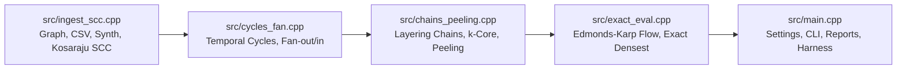

# Codebase Analysis: Money-Laundering Ring Detection

## 1. Overview & Architecture

This repository implements a deterministic, graph-theoretic **Money-Laundering Ring Detector** in standard C++17 (zero external dependencies). It targets the **IBM Synthetic AML Transaction Dataset** (`HI-Small_Trans.csv`, 11-column CSV layout) and detects five recurring illicit transaction structures without machine learning: **temporal cycles (round-tripping)**, **fan-out**, **fan-in (smurfing)**, **pass-through chains (layering)**, and **dense subgraphs / $k$-cores (collusive rings)**.

### Clean Layered Architecture
The codebase (~1,400 lines of modern C++17) is organized into four modular files plus a clean top-level `main.cpp`:

---

## 2. Core Data Models

| Structure | Location | Description & Invariants |
| :--- | :--- | :--- |
| `Edge` | [ingest_scc.cpp](../src/ingest_scc.cpp) | Represents a single transfer (`from`, `to`, `amount` from the *Amount Paid* column, UTC `time` in epoch seconds, and ground-truth `isLaundering`). |
| `Graph` | [ingest_scc.cpp](../src/ingest_scc.cpp) | Directed temporal graph $G = (V, E)$. Accounts are mapped to integer IDs $0 \dots n-1$. Calling `build()` stably sorts `edges` by timestamp in $O(m \log m)$ and populates `outEdges` and `inEdges`. Every adjacency list is in chronological order, enabling $O(\log \deg(u))$ binary search (`firstAtOrAfter`). Self-loops are filtered during ingestion. |
| `SimpleGraph` | [chains_peeling.cpp](../src/chains_peeling.cpp) | Simple undirected projection $H$ of $G$ built in $O(m \log m)$ (`makeUndirected`), collapsing parallel and reverse transfers between accounts. Used by $k$-core and densest-subgraph detectors. |

---

## 3. Module-by-Module Breakdown

### 1. Ingestion, Synthetic Data & Kosaraju's SCC ([ingest_scc.cpp](../src/ingest_scc.cpp))
- **CSV Ingestion ([loadCsv](../src/ingest_scc.cpp)):** Parses the 11-column IBM AML format. Skips malformed rows and discards self-loops cleanly into `LoadStats`.
- **Synthetic Generator ([generateSynthetic](../src/ingest_scc.cpp)):** Generates background transfers (`Is Laundering = 0`) plus planted cycles (3–6 hops), fan-outs (8 recipients), fan-ins (8 senders), pass-through chains (4–6 hops), and 8-vertex cliques (`Is Laundering = 1`).
- **Kosaraju's SCC ([kosarajuScc](../src/ingest_scc.cpp)):** Computes strongly connected components in $O(n + m)$ using two DFS passes. Implemented with an explicit stack to prevent recursion overflow on deep graphs.

### 2. Temporal Cycles (Round-Tripping) & Fan-Out / Fan-In (Smurfing) ([cycles_fan.cpp](../src/cycles_fan.cpp))
- **Bounded Temporal Cycle Search ([findTemporalCycles](../src/cycles_fan.cpp)):**
  - Finds simple directed cycles of $2 \le k \le K$ edges (default $K=6$) where timestamps are non-decreasing and span at most $W$ seconds (default $168\text{h}$).
  - Prunes cross-SCC edges using `scc.comp` and uses binary search (`firstAtOrAfter`) to step through chronological hops. Backtracking explores candidates without redundant rotations.
- **Sliding-Window Fan Detector ([findFans](../src/cycles_fan.cpp)):**
  - Detects accounts sending to (fan-out) or receiving from (fan-in) at least $k$ distinct counterparties (default $k=5$) within $W$ seconds (default $24\text{h}$).
  - Two-pointer sliding window over time-sorted adjacency lists in $O(n + m)$ total time.

### 3. Layering Chains, $k$-Core & Greedy Peeling ([chains_peeling.cpp](../src/chains_peeling.cpp))
- **Pass-Through Chains ([findChains](../src/chains_peeling.cpp)):**
  - Identifies layering walks where funds are forwarded within delay $D$ and fee tolerance $\varepsilon$.
  - Solved as a longest path in a DAG using forward and backward dynamic programming passes in chronological order.
- **$k$-Core & Greedy Peeling ([peel](../src/chains_peeling.cpp)):**
  - Repeatedly removes the minimum-degree vertex from $H$ using a priority queue (`std::set<pair<int, int>>`).
  - Computes exact $k$-core numbers and yields Charikar's $\frac{1}{2}$-approximate densest subgraph.

### 4. Edmonds-Karp Max-Flow, Exact Densest Subgraph & Evaluation ([exact_eval.cpp](../src/exact_eval.cpp))
- **Edmonds-Karp Algorithm ([MaxFlow](../src/exact_eval.cpp)):**
  - Computes maximum flow via shortest augmenting paths using BFS.
- **Exact Densest Subgraph ([exactDensest](../src/exact_eval.cpp)):**
  - Formulates densest subgraph extraction as Goldberg's min-cut reduction.
  - Prunes the network to the $\lceil \rho_{\text{greedy}} \rceil$-core, shrinking the graph on IBM HI-Small from 515,000 accounts to 862 accounts.
  - Iteratively updates candidate density $p/q$ until convergence (1 to 3 min-cuts).

### 5. CLI Program & Global Configuration ([main.cpp](../src/main.cpp))
- Holds central detector constants (`CYCLE_MAX_LENGTH`, `FAN_MIN_PARTNERS`, etc.).
- Orchestrates `test`, `generate`, `detect`, and `evaluate` subcommands.

---

## 4. Empirical Results on IBM `HI-Small_Trans.csv`

Dataset: **515,088 accounts**, **4,487,133 valid transfers** (591,212 self-loops filtered out at ingestion, **5,166** labelled laundering transfers).

| Detector | Flagged | Correct | Precision | Recall | $F_1$ | Time (s) | Notes |
| :--- | ---: | ---: | ---: | ---: | ---: | ---: | :--- |
| Temporal cycles | 8,592 | 531 | 0.0618 | 0.1028 | 0.0772 | 1.872 | 11,959 cycles |
| Fan-out | 1,169,117 | 1,338 | 0.0011 | 0.2590 | 0.0023 | 0.090 | 13,443 centres |
| Fan-in | 102,873 | 1,021 | 0.0099 | 0.1976 | 0.0189 | 0.089 | 6,906 centres |
| Pass-through chains | 8,261 | 59 | 0.0071 | 0.0114 | 0.0088 | 1.333 | longest chain 4 |
| Max $k$-core | 115 | 66 | 0.5739 | 0.0128 | 0.0250 | 0.570 | $k = 5$ |
| Greedy densest | 70 | 66 | 0.9429 | 0.0128 | 0.0252 | 0.570 | 14 accounts, density 3.643 |
| Exact densest | 321 | 0 | 0.0000 | 0.0000 | 0.0000 | 0.012 | 81 accounts, density 3.889, 3 min cuts |
| **Union of pattern detectors** | **1,277,262** | **2,820** | **0.0022** | **0.5459** | **0.0044** | **3.384** | cycles, fans, chains |
