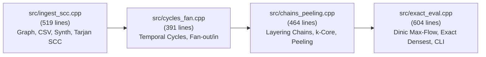

# Codebase Analysis: Money-Laundering Ring Detection

## 1. Overview & Architecture

This repository implements a deterministic, graph-theoretic **Money-Laundering Ring Detector** in standard C++17 (zero external dependencies). It targets the **IBM Synthetic AML Transaction Dataset** (`HI-Small_Trans.csv`, 11-column CSV layout) and detects five recurring illicit transaction structures without machine learning: **temporal cycles (round-tripping)**, **fan-out**, **fan-in (smurfing)**, **pass-through chains (layering)**, and **dense subgraphs / $k$-cores (collusive rings)**.

### Single-Program Include-Chain Design
The codebase (**1,974 lines** of C++17) is structured as a 4-file linear `#include` chain, organizing the detector pipeline into four cumulative modules that can each be compiled and tested standalone or as a unified binary (`./aml`):

Each file uses `AML_INCLUDED` and `AML_STANDALONE_<MODULE>` preprocessor guards so compiling any module standalone defines `main()` and runs cumulative self-tests up through that module, while compiling [exact_eval.cpp](../src/exact_eval.cpp) builds the full CLI (`test`, `generate`, `detect`, `evaluate`).

---

## 2. Core Data Models

| Structure | Location | Description & Invariants |
| :--- | :--- | :--- |
| `Edge` | [ingest_scc.cpp](../src/ingest_scc.cpp#L54-L60) | Represents a single transfer (`from`, `to`, `amount` from the *Amount Paid* column, UTC `timestamp` in epoch seconds, and ground-truth `isLaundering`). Parallel edges and self-loops are preserved. |
| `Graph` | [ingest_scc.cpp](../src/ingest_scc.cpp#L65-L112) | Directed temporal multigraph $G = (V, E)$. Accounts (`bank:account`) are interned to $0 \dots n-1$. Calling `finalize()` stably sorts `edges` by timestamp in $O(m \log m)$ and populates `outAdj` and `inAdj`. **Key Invariant:** Every adjacency list stores edge indices in strictly increasing index order and non-decreasing timestamp order, enabling $O(\log \deg(u))$ binary search (`firstOutAtOrAfter`). |
| `UndirectedGraph` | [chains_peeling.cpp](../src/chains_peeling.cpp#L126-L150) | Simple undirected projection $H$ of $G$ built in $O(m \log m)$ (`buildUndirected`), collapsing parallel/reverse edges and stripping self-loops. Used by $k$-core and densest-subgraph detectors. |

---

## 3. Module-by-Module Breakdown

### 1. Ingestion, Synthetic Data & Tarjan's SCC ([ingest_scc.cpp](../src/ingest_scc.cpp))
- **CSV Ingestion ([loadCsv](../src/ingest_scc.cpp#L175-L202)):** Parses the 11-column IBM AML format using a custom portable Gregorian calendar converter ([daysFromCivil](../src/ingest_scc.cpp#L135-L142), avoiding non-portable `timegm`). Gracefully skips and counts malformed rows in `IngestStats`.
- **Synthetic Generator ([generateSynthetic](../src/ingest_scc.cpp#L236-L293)):** Generates random background transfers (`Is Laundering = 0`) plus planted cycles (3–6 hops), fan-outs (8 recipients), fan-ins (8 senders), pass-through chains (4–6 hops, 2–5% fee drop), and 8-vertex cliques (`Is Laundering = 1`).
- **Tarjan's SCC ([tarjanScc](../src/ingest_scc.cpp#L306-L359)):** Computes strongly connected components in $O(n + m)$ time. Implemented **iteratively** with an explicit `callStack` of `(vertex, outAdj_position)` pairs to prevent call-stack overflow on deep graphs (verified on a 200,000-vertex cycle).

### 2. Temporal Cycles (Round-Tripping) & Fan-Out / Fan-In (Smurfing) ([cycles_fan.cpp](../src/cycles_fan.cpp))
- **Bounded Temporal Cycle Search ([CycleFinder](../src/cycles_fan.cpp#L33-L101)):**
  - Finds simple directed cycles of $2 \le k \le K$ edges (default $K=6$) where timestamps are non-decreasing and span at most $W$ seconds (default $168\text{h}$).
  - **Pruning & Canonicalization:** Skips edges whose endpoints lie in different SCCs (`scc.comp[u] != scc.comp[v]`), binary-searches via `g.firstOutAtOrAfter` for the first out-edge with $t(f) \ge \tau$, halts scan as soon as $t(f) > t(e_1) + W$, and enforces `idx > rootIndex` so each temporal cycle is reported **exactly once**.
  - **Complexity:** $O(m \cdot d^{K-1})$, where $d$ is the maximum number of out-edges of a vertex within a window $W$ (capped by `maxCycles = 1,000,000`).
- **Sliding-Window Fan Detector ([findFans](../src/cycles_fan.cpp#L132-L176)):**
  - Detects accounts sending to (fan-out) or receiving from (fan-in) at least $k$ distinct counterparties (default $k=5$) within $W$ seconds (default $24\text{h}$), ignoring self-loops.
  - Uses a two-pointer sliding window (`left`, `right`) over each vertex's time-sorted adjacency list with per-counterparty frequency counts and `markedUpTo` tracking so every qualifying edge is flagged in $O(n + m)$ total time.

### 3. Layering Chains, $k$-Core & Charikar's Greedy Peeling ([chains_peeling.cpp](../src/chains_peeling.cpp))
- **Pass-Through Chains ([findChains](../src/chains_peeling.cpp#L74-L120)):**
  - Models layering walks $e_1, \dots, e_k$ where edge $f$ *follows* edge $e$ if $\text{tail}(f) = \text{head}(e)$, $\text{index}(f) > \text{index}(e)$, $0 \le t(f) - t(e) \le D$ (default $24\text{h}$), and $(1 - \varepsilon)a(e) \le a(f) \le a(e)$ (default $\varepsilon = 0.10$).
  - Because `index(f) > index(e)`, the "follows" relation forms a DAG topologically ordered by edge index. Dynamic programming computes `back[e]` (longest chain ending at $e$) and `fwd[e]` (longest chain starting at $e$) in $O(m(\log d + c))$ time, flagging edges where `back[e] + fwd[e] - 1 >= L` (default $L=3$).
- **$k$-Core & Charikar's Greedy Peeling ([peel](../src/chains_peeling.cpp#L169-L224)):**
  - Repeatedly removes a vertex of minimum degree from the undirected projection $H$ using a bucket queue with lazy deletion in $O(n + m)$ time.
  - Simultaneously computes exact $k$-core numbers (`coreNumber[v]`) and tracks the subgraph maximizing $\rho(S) = |E(S)| / |S|$ using exact cross-multiplication (`edgesLeft * bestVertices > bestEdges * verticesLeft`), yielding a proven $\frac{1}{2}$-approximation to the Densest Subgraph problem.

### 4. Dinic's Max-Flow, Exact Densest Subgraph & Evaluation Harness ([exact_eval.cpp](../src/exact_eval.cpp))
- **Dinic's Algorithm ([MaxFlow](../src/exact_eval.cpp#L36-L139)):**
  - Fully iterative level-graph BFS and blocking-flow DFS with current-arc pointers (`it[u]`) and dead-end pruning (`level[u] = -1`), running in $O(V^2 E)$ with 64-bit integer capacities.
- **Exact Densest Subgraph ([findDensestExact](../src/exact_eval.cpp#L168-L235)):**
  - Applies **core pruning** first: since every vertex in an optimal densest subgraph $S^*$ has degree at least $\lceil \rho^* \rceil \ge \lceil \rho_{\text{greedy}} \rceil$, the flow network is restricted to the $\lceil \rho_{\text{greedy}} \rceil$-core.
  - Uses **Goldberg's minimum-cut reduction** coupled with **Dinkelbach iteration** (starting from $p/q = \rho_{\text{greedy}}$ and updating $p/q$ to the density of the source-side cut $S$ whenever $q|E(S)| - p|S| > 0$) using exact integer capacities:
    $$\text{cap}(s \to v) = mq, \quad \text{cap}(v \to t) = mq + 2p - \deg(v)q, \quad \text{cap}(u \leftrightarrow v) = q$$
- **Evaluation Harness ([evaluate](../src/exact_eval.cpp#L348-L381)):**
  - Scores each of the 7 detectors plus the union of the 4 pattern detectors (`Temporal cycles`, `Fan-out`, `Fan-in`, `Pass-through chains`) against ground-truth `Is Laundering` labels (excluding self-loops), outputting Markdown tables of Precision, Recall, $F_1$, and runtime scaling across $25\%, 50\%, 75\%, 100\%$ temporal prefixes.

---

## 4. Inter-Module Dependencies & Data Flow

| Producer File | Exported Symbols / Outputs | Consumed By | Purpose in Consumer |
| :--- | :--- | :--- | :--- |
| [ingest_scc.cpp](../src/ingest_scc.cpp) | `Edge`, `Graph`, `Graph::firstOutAtOrAfter`, `IngestStats`, `loadCsv`, `generateSynthetic` | `cycles_fan.cpp`, `chains_peeling.cpp`, `exact_eval.cpp` | Provides the time-sorted multigraph $G$, adjacency binary search, and CSV I/O / synthetic data |
| [ingest_scc.cpp](../src/ingest_scc.cpp) | `SccResult`, `tarjanScc` | `cycles_fan.cpp`, `exact_eval.cpp` | SCC component IDs prune cross-SCC edges in `CycleFinder` |
| [ingest_scc.cpp](../src/ingest_scc.cpp) | `countFlagged`, `secondsSince`, `CHECK`, `testIngestScc`, `reportIngestScc` | `cycles_fan.cpp`, `chains_peeling.cpp`, `exact_eval.cpp` | Shared flagging metrics, timing, test assertions, and cumulative test/report orchestration |
| [cycles_fan.cpp](../src/cycles_fan.cpp) | `CycleParams`, `findTemporalCycles`, `cycleEdges`, `FanParams`, `FanResult`, `findFans`, `reportCyclesFan`, `testCyclesFan` | `exact_eval.cpp` (`runAll`, `runAllTests`, `main`) | Supplies cycle/fan edge flags, metrics, and self-tests to the harness and CLI |
| [chains_peeling.cpp](../src/chains_peeling.cpp) | `ChainParams`, `ChainResult`, `findChains`, `edgesInside`, `inKCore`, `reportChainsPeeling`, `testChainsPeeling` | `exact_eval.cpp` (`runAll`, `runAllTests`, `main`) | Supplies chain edge flags, $k$-core edge masks, and self-tests |
| [chains_peeling.cpp](../src/chains_peeling.cpp) | `UndirectedGraph`, `buildUndirected`, `PeelResult`, `peel` | `exact_eval.cpp` (`findDensestExact`, `runAll`, `reportExactDensest`, `testExactEval`) | Provides simple graph $H$, greedy density $p/q$, and core numbers for $\lceil \rho_{\text{greedy}} \rceil$-core pruning |
| [chains_peeling.cpp](../src/chains_peeling.cpp) | `edgesWithin`, `bruteDensest` | `exact_eval.cpp` (`testExactEval`) | Reused directly as the $2^n$ brute-force oracle for exact densest subgraph self-tests |
| [exact_eval.cpp](../src/exact_eval.cpp) | `MaxFlow`, `ExactResult`, `findDensestExact`, `runAll`, `evaluate`, `main` | End user (CLI `./aml`) | Produces terminal reports (`detect`), Markdown evaluation tables (`evaluate`), synthetic CSVs (`generate`), and test summaries (`test`) |

---

## 5. Verification Suite & Workspace Datasets

Every module includes self-tests that compare the fast algorithms against independent brute-force implementations across **14,400 random graph instances** (72 `CHECK` assertions total, 0 failures):

| Module | Verification Target | Independent Oracle | Random Trials |
| :--- | :--- | :--- | ---: |
| `src/ingest_scc.cpp` | `tarjanScc` | Floyd-Warshall transitive closure (`reachability`) | 1,000 |
| `src/cycles_fan.cpp` | `findTemporalCycles` | Exhaustive $K$-edge sequence enumeration (`bruteCycles`) | 400 |
| `src/cycles_fan.cpp` | `findFans` | $O(\deg(u)^3)$ all-pairs window check (`bruteFans`) | 2,000 |
| `src/chains_peeling.cpp` | `findChains` | Exhaustive DFS walk enumeration (`bruteChains`) | 3,000 |
| `src/chains_peeling.cpp` | `peel` ($k$-core & $\frac{1}{2}$-approx) | Iterative degree-peeling (`naiveCores`) & $2^n$ subset enumeration (`bruteDensest`) | 3,000 |
| `src/exact_eval.cpp` | `MaxFlow` (Dinic) | $2^n$ $s$-$t$ cut enumeration | 2,000 |
| `src/exact_eval.cpp` | `findDensestExact` | $2^n$ subset enumeration (with and without core pruning) | 3,000 |

### Workspace Datasets & Files
- `aml_test_graph.csv`: 10 lines (header + 9 rows, including 1 malformed row, parallel edges, a 3-cycle, and a self-loop) used in `testIngestScc()`.
- `aml_test_synth.csv`: 5,056 lines (5,000 background transfers + planted patterns, `seed = 7`) used in `testIngestScc()` generator round-trip checks.
- `aml_test_e2e.csv`: 10,075 lines (10,000 background transfers among 2,000 accounts + planted patterns, `seed = 3`) used in `testExactEval()` end-to-end checks.
- [synth.csv](../data/synth.csv): 20,132 lines (20,000 background transfers among 20,000 accounts + 131 labelled laundering transfers: 4 cycles, 4 fan-outs, 4 fan-ins, 4 chains, 1 eight-account clique).
- [HI-Small_Trans.csv](../data/HI-Small_Trans.csv): 5,078,346 lines (5,078,345 transfers across 515,088 accounts; 5,177 labelled laundering transfers), the real IBM Synthetic AML benchmark (gitignored due to ~454 MB size).
- [results.md](results.md): Saved output of `./aml evaluate data/HI-Small_Trans.csv` and `./aml detect data/HI-Small_Trans.csv`.
- [report.pdf](../report/report.pdf) / [report.tex](../report/report.tex) and [presentation.pdf](../presentation/presentation.pdf) / [presentation.tex](../presentation/presentation.tex): Project report and 21-slide Beamer presentation.

---

## 6. Empirical Results

### A. Observed Run on `synth.csv` (`./aml detect synth.csv` & `./aml evaluate synth.csv`)
Dataset: **17,393 accounts**, **20,131 transfers** (0 skipped, 0 self-loops, **131** labelled laundering, max out/in-degree `10 / 9`, 17,219 SCCs with 7 non-trivial and largest size 155). Default parameters: `K=6, W=168h; fan k=5, W=24h; chain L=3, D=24h, eps=0.10`.

| Detector | Flagged | True Positives | Precision | Recall | $F_1$ | Time (s) | Notes |
| :--- | ---: | ---: | ---: | ---: | ---: | ---: | :--- |
| Temporal cycles | 18 | 18 | 1.0000 | 0.1374 | 0.2416 | 0.001 | 4 cycles |
| Fan-out | 33 | 32 | 0.9697 | 0.2443 | 0.3902 | 0.000 | 4 centres |
| Fan-in | 32 | 32 | 1.0000 | 0.2443 | 0.3926 | 0.000 | 4 centres |
| Pass-through chains | 39 | 39 | 1.0000 | 0.2977 | 0.4588 | 0.001 | longest chain 6 |
| Max $k$-core | 28 | 28 | 1.0000 | 0.2137 | 0.3522 | 0.002 | $k = 7$ (8 vertices) |
| Greedy densest | 28 | 28 | 1.0000 | 0.2137 | 0.3522 | 0.002 | 8 vertices, density 3.500 |
| Exact densest | 28 | 28 | 1.0000 | 0.2137 | 0.3522 | 0.000 | 8 vertices, density 3.500, 1 min cut |
| **Union of pattern detectors** | **104** | **103** | **0.9904** | **0.7863** | **0.8766** | **0.001** | cycles, fans, chains |

*Prefix scaling on `synth.csv` (`5,032 / 10,065 / 15,098 / 20,131` edges):* Peeling took `0.001 / 0.001 / 0.002 / 0.002 s`; all other detectors finished in `<= 0.001 s` per prefix. Because average background degree is ~2, the planted 8-clique (density `3.500`, $k=7$) stands out cleanly and is recovered with **1.0000 precision** after 1 min-cut check.

### B. 200,000-Transfer Synthetic Benchmark (from [report.pdf](../report/report.pdf))
Dataset: **200,000** random background transfers among **20,000** accounts + 40 of each pattern + 6 eight-account cliques (**1,196** labelled transfers).

| Detector | Flagged | TP | Precision | Recall | $F_1$ | Time (s) |
| :--- | ---: | ---: | ---: | ---: | ---: | ---: |
| Temporal cycles | 422 | 179 | 0.424 | 0.150 | 0.221 | 0.176 |
| Fan-out | 677 | 320 | 0.473 | 0.268 | 0.342 | 0.005 |
| Fan-in | 688 | 325 | 0.472 | 0.272 | 0.345 | 0.003 |
| Pass-through chains | 592 | 388 | 0.655 | 0.324 | 0.434 | 0.028 |
| Max $k$-core ($k=14$) | 173,798 | 1,103 | 0.006 | 0.922 | 0.013 | 0.037 |
| Greedy densest | 199,169 | 1,196 | 0.006 | 1.000 | 0.012 | 0.037 |
| Exact densest | 199,169 | 1,196 | 0.006 | 1.000 | 0.012 | 0.074 |
| **Union of pattern detectors** | **2,196** | **1,031** | **0.470** | **0.862** | **0.608** | **0.212** |

*Prefix scaling on 25/50/75/100%:* Peeling scaled linearly (`0.009, 0.018, 0.029, 0.037 s`); temporal cycles grew as `0.011, 0.061, 0.109, 0.176 s`, consistent with $O(m \cdot d^{K-1})$. Full `evaluate` completed in `1.3 s`. At average degree ~20, the uniform random background has higher density than an 8-clique (`3.5`), causing the global densest-subgraph detector to select the bulk graph instead of isolated cliques.

### C. IBM Synthetic AML Benchmark (`HI-Small_Trans.csv`)
Dataset: **515,088 accounts**, **5,078,345 transfers** (0 skipped, **591,212** self-loops, **5,177** labelled laundering transfers — **5,166** non-self-loops plus **11** on self-loops, base rate $\approx 0.115\%$; max out/in-degree `168,672 / 1,084`, loaded in `3.602 s`; **494,769 SCCs** with `2,928` non-trivial and largest size `17,075` in `0.116 s`; **644,246** simple undirected edges).

| Detector | Flagged | True Positives | Precision | Recall | $F_1$ | Time (s) | Notes |
| :--- | ---: | ---: | ---: | ---: | ---: | ---: | :--- |
| Temporal cycles | 8,592 | 531 | 0.0618 | 0.1028 | 0.0772 | 1.907 | 11,959 cycles |
| Fan-out | 1,169,117 | 1,338 | 0.0011 | 0.2590 | 0.0023 | 0.094 | 13,443 centres |
| Fan-in | 102,873 | 1,021 | 0.0099 | 0.1976 | 0.0189 | 0.100 | 6,906 centres |
| Pass-through chains | 8,261 | 59 | 0.0071 | 0.0114 | 0.0088 | 1.759 | longest chain 4 |
| Max $k$-core | 115 | 66 | 0.5739 | 0.0128 | 0.0250 | 0.335 | $k = 5$ (26 vertices) |
| Greedy densest | 227 | 66 | 0.2907 | 0.0128 | 0.0245 | 0.335 | 54 vertices, density 3.574 |
| Exact densest | 321 | 0 | 0.0000 | 0.0000 | 0.0000 | 0.007 | 81 vertices, density 3.889, 3 min cuts |
| **Union of pattern detectors** | **1,277,262** | **2,820** | **0.0022** | **0.5459** | **0.0044** | **3.860** | cycles, fans, chains |

*Prefix scaling on `HI-Small_Trans.csv` (`25% / 50% / 75% / 100%`):*
- `1,269,586 (25%)`: Cycles `0.058s`, Fan-out `0.015s`, Fan-in `0.014s`, Chains `0.170s`, Peeling `0.084s`, Exact densest `2.785s`.
- `2,539,172 (50%)`: Cycles `0.109s`, Fan-out `0.045s`, Fan-in `0.050s`, Chains `0.688s`, Peeling `0.187s`, Exact densest `0.092s`.
- `3,808,758 (75%)`: Cycles `0.549s`, Fan-out `0.071s`, Fan-in `0.076s`, Chains `1.200s`, Peeling `0.263s`, Exact densest `0.269s`.
- `5,078,345 (100%)`: Cycles `1.907s`, Fan-out `0.094s`, Fan-in `0.100s`, Chains `1.759s`, Peeling `0.335s`, Exact densest `0.007s` (core pruning shrunk the flow network to `862` vertices and `2,339` edges).

---

## 7. Known Limitations & Potential Improvements

1. **Cross-Currency Transfers in Chains & Ingestion:** `loadCsv` reads column 7 (`Amount Paid`) without currency normalization, so `follows()` in [chains_peeling.cpp](../src/chains_peeling.cpp#L33-L40) compares raw numerical values across potentially different currencies.
2. **Single Dense Subgraph Extraction:** Both `peel` and `findDensestExact` extract only one global densest subgraph. Iteratively removing the found densest set or running on heavy-tailed real transaction graphs would isolate multiple localized rings.
3. **64-Bit Capacity Scaling in Exact Densest Subgraph:** In `findDensestExact`, source/sink arc capacities are $m \cdot q$, and the total cut capacity reaches $m \cdot n \cdot q$. Since $q \le n$, $m \cdot n^2$ fits in signed 64-bit `long long` for `HI-Small_Trans.csv`, but could overflow on massive graphs without sufficient core pruning.
4. **Legitimate High-Degree Hubs in Fan Detection:** `findFans` flags all accounts meeting the counterparty count threshold $k$ within window $W$, which can include payroll accounts or merchant hubs unless filtered by payment format or amount thresholds.
