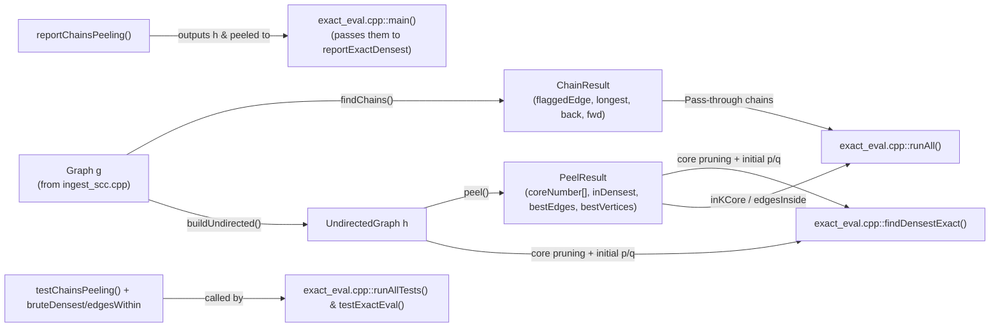

# Learning Guide: `chains_peeling.cpp` (Pass-Through Chains, $k$-Core & Greedy Peeling)

> **Role in the Pipeline:** Layering & Dense-Group Layer (Layer 3 of 4). Detects **Pass-Through Chains** (layering walks via DAG DP), projects the directed multigraph to a simple undirected graph $H$, computes exact **$k$-core decomposition**, and runs **Charikar's greedy peeling** ($\frac{1}{2}$-approximate densest subgraph) which also seeds the exact solver in `exact_eval.cpp`.

---

## Part 1: The Problem & How We Tackled It (Project Overview)

### 1.1 What Problem We Took On
Financial institutions record massive streams of bank transfers. Money launderers hide illicit funds inside ordinary payment traffic by structuring transfers into recognizable topological and temporal patterns. The target input is the 11-column **IBM Synthetic AML Transaction Dataset** (`HI-Small_Trans.csv`), where every row records:

```text
Timestamp, From Bank, Account, To Bank, Account, Amount Received, Receiving Currency, Amount Paid, Payment Currency, Payment Format, Is Laundering
```

Our goal is to **flag individual transfers (`Edge`s) that participate in money-laundering rings**, and evaluate detection quality (Precision, Recall, $F_1$) and scaling against the ground-truth `Is Laundering` label across **five recurring laundering typologies**:

1. **Round-Tripping (Temporal Cycles):** Funds leave an account and loop back to the same origin within $W$ seconds across $2 \le k \le K$ hops with non-decreasing timestamps.
2. **Smurfing — Fan-Out:** A single source account splits money across $\ge k$ distinct recipient accounts within a short window $W$.
3. **Smurfing — Fan-In:** $\ge k$ distinct sender accounts funnel funds into a single collector account within window $W$.
4. **Layering (Pass-Through Chains):** A sequence of $\ge L$ consecutive transfers where each intermediary forwards almost all ($1 - \varepsilon$ to $100\%$) of the amount it received within delay $D$.
5. **Collusive Rings (Dense Subgraphs / $k$-Cores):** Tightly knit groups of accounts transacting heavily among themselves, forming subgraphs of unusually high edge density $\rho(S) = |E(S)| / |S|$.

### 1.2 How We Tackled It
- **Pure Deterministic Graph Theory (No Machine Learning):** Rather than training black-box models or clustering heuristics, every laundering structure is given a **formal mathematical definition**, an **exact or provably bounded graph algorithm**, a **correctness proof / invariant**, and a **time complexity bound**.
- **Dual Graph Representation:**
  - A **directed temporal multigraph** $G = (V, E)$ keeps parallel transfers (repeated transfers between the same pair carry signal) and self-loops (tracked and skipped explicitly by detectors), with edges sorted chronologically.
  - A **simple undirected projection** $H$ collapses parallel/reverse transfers and removes self-loops for dense-subgraph and $k$-core optimization.
- **Four-File Cumulative `#include` Chain:** The system is one C++17 standard-library-only program split into four layered modules:
  ```text
  ingest_scc.cpp  ──▶  cycles_fan.cpp  ──▶  chains_peeling.cpp  ──▶  exact_eval.cpp (main CLI)
  ```
  Preprocessor guards (`AML_INCLUDED`, `AML_STANDALONE_<MODULE>`) allow each file to compile standalone and run cumulative self-tests for itself and earlier layers, while compiling [exact_eval.cpp](../src/exact_eval.cpp) builds the unified `./aml` CLI (`test`, `generate`, `detect`, `evaluate`).
- **Tested Before Trusted:** Every fast algorithm is verified against an independent brute-force oracle across **14,400 random graphs** (72 total `CHECK` assertions, 0 failures) plus hand-crafted boundary tests.

---

## Part 2: Deep Dive into `chains_peeling.cpp`

### 2.1 How It Fits Into the Project
[chains_peeling.cpp](../src/chains_peeling.cpp) completes the pattern detectors (adding **Pass-Through Chains**) and introduces the **dense-group pipeline**: building the simple undirected projection $H$, computing **$k$-core numbers**, and finding a **$\frac{1}{2}$-approximate densest subgraph** whose density and core numbers directly accelerate the exact min-cut solver in [exact_eval.cpp](../src/exact_eval.cpp).

### 2.2 Pass-Through Chains (Layering) via DAG Dynamic Programming
- **Structs & Functions:** `ChainParams` (`minLength = 3`, `maxDelay = 86400LL`, `tolerance = 0.10`), `follows`, `ChainResult`, `lowerBoundTime`, `findChains` ([chains_peeling.cpp](../src/chains_peeling.cpp#L22-L120)).
- **Formal Definition (`follows`):** Edge $f$ follows edge $e$ iff:
  1. Neither $e$ nor $f$ is a self-loop, and $\text{tail}(f) = \text{head}(e)$.
  2. `fIdx > eIdx` (which guarantees $t(f) \ge t(e)$ because `g.edges` is time-sorted).
  3. Delay is bounded: $t(f) - t(e) \le D$.
  4. Amount stays within the pass-through band: $(1 - \varepsilon) \cdot a(e) \le a(f) \le a(e)$.
- **Why Walks (Not Simple Paths)?** Requiring distinct vertices would turn longest-chain detection into NP-hard Longest Simple Path. Allowing vertices to repeat (while edges cannot repeat because indices strictly increase) makes the `follows` relation a **Directed Acyclic Graph (DAG)** in topological edge-index order `0..m-1`.
- **Two-Pass Dynamic Programming (`findChains`):**
  - **Forward pass (`f = 0..m-1`):** Computes `back[f]`, the longest chain ending at edge `f`, by binary-searching `g.inAdj[edge.from]` at `edge.timestamp - params.maxDelay` and scanning predecessors `e < f`.
  - **Backward pass (`e = m-1..0`):** Computes `fwd[e]`, the longest chain starting at edge `e`, by binary-searching `g.outAdj[edge.to]` at `edge.timestamp` and scanning successors up to `edge.timestamp + params.maxDelay`.
  - **Chain Invariant:** Because `follows` only constrains consecutive edges, the longest chain passing through `e` has length `back[e] + fwd[e] - 1`. Edge `e` is flagged iff `back[e] + fwd[e] - 1 >= params.minLength`.
  - `ChainResult::chainThrough(e)` reconstructs an actual longest chain through `e` by walking `prevEdge` backward and `nextEdge` forward.
- **Complexity:** $O(m (\log d + c))$, where $c$ is the maximum number of transfers an account sends/receives within $D$ seconds.

### 2.3 Simple Undirected Projection (`UndirectedGraph`, `buildUndirected`)
([chains_peeling.cpp](../src/chains_peeling.cpp#L126-L150))
- Drops self-loops and maps every directed transfer `(from, to)` to an unordered pair `{min(from, to), max(from, to)}`.
- Sorts and deduplicates pairs in $O(m \log m)$ so parallel transfers and reverse transfers collapse into a single undirected edge.
- **Why collapse?** A single pair of accounts bouncing $100 back and forth 50 times would artificially inflate a 2-vertex set's density to 25.0 without forming a multi-account ring. Projecting to a simple undirected graph $H$ ensures density reflects the richness of connections *between distinct accounts*.

### 2.4 $k$-Core Decomposition & Charikar's Greedy Peeling (`peel`)
([chains_peeling.cpp](../src/chains_peeling.cpp#L155-L242))
- **Algorithm (`peel(h)`):** Repeatedly deletes a vertex `v` of current minimum degree `deg[v]` in $H$:
  - Uses a **bucket queue** `bucket[0..maxDeg]` with **lazy deletion** (decrementing a neighbor's degree pushes it into `bucket[deg[u]]`; stale entries are skipped when popped if `removed[cand]` or `deg[cand] != cur`).
  - Tracks `level = std::max(level, deg[v])`, setting `coreNumber[v] = level` (exact $k$-core number: the largest $k$ such that $v$ belongs to a subgraph of minimum degree $\ge k$).
  - After each deletion, compares the remaining set's density `edgesLeft / verticesLeft` against `bestEdges / bestVertices` using exact integer cross-multiplication (`edgesLeft * res.bestVertices > res.bestEdges * verticesLeft`), recording `bestStep`.
  - Reconstructs `inDensest` as all vertices peeled from `bestStep` onward.
- **Complexity:** $O(n + m)$ (since `cur` decreases by at most 1 per step, total bucket scans are linear in $n + m$).
- **Proof of $\frac{1}{2}$-Approximation (Charikar's Theorem):**
  - Let $S^*$ be an optimal densest subgraph with density $\rho^* = |E(S^*)| / |S^*|$.
  - Every $v \in S^*$ must have at least $\rho^*$ neighbors inside $S^*$ (otherwise removing $v$ would strictly increase density).
  - Consider the step right before the *first* vertex $v \in S^*$ is deleted. The remaining vertex set $T \supseteq S^*$ still contains all of $S^*$, so $\deg_T(v) \ge \deg_{S^*}(v) \ge \rho^*$.
  - Because the greedy algorithm always picks a **true minimum-degree** vertex, every vertex in $T$ has degree at least $\rho^*$. Summing degrees gives $2|E(T)| \ge \rho^* |T|$, so $\rho(T) = |E(T)| / |T| \ge \rho^* / 2$. Since $T$ is one of the $n$ sets evaluated, the returned density is at least $\rho^* / 2$.
- **Helper Projections (`edgesInside`, `inKCore`):** Map vertex sets (`inDensest` or `inKCore(peeled, peeled.maxCore)`) back onto the original directed multigraph $G$ by flagging all non-self-loop edges with both endpoints inside the vertex set.

### 2.5 Self-Tests (`testChainsPeeling`)
([chains_peeling.cpp](../src/chains_peeling.cpp#L280-L453))
1. **Hand-made Chain Graph:** Tests `A -1000-> B -980-> C -950-> D` at 10s intervals plus `D -500-> E` (fails $\varepsilon=0.10$), `B -990-> F` (5 days later, fails $D$), and `C->C` self-loop, testing boundary parameters (`maxDelay = 9 vs 10`, `tolerance = 0.02 vs 0.6`).
2. **3,000 Random Graphs vs `bruteChains`:** Exhaustively enumerates every chain and checks `back[i] + fwd[i] - 1`, `flaggedEdge[i]`, and `chainThrough(i)` validity on all 3,000 graphs (`0` mismatches).
3. **Hand-made Clique + Tail Graph:** Verifies that parallel, reverse, and self-loop edges collapse properly into $H$ (`6` vertices, `8` undirected edges), `maxCore == 3`, `bestEdges == 6, bestVertices == 4` (density `1.5`), and `8` directed transfers inside.
4. **3,000 Random Graphs vs `naiveCores` & `bruteDensest`:** Checks core numbers match naive iterative deletion and greedy density satisfies $\frac{1}{2}\rho^* \le \rho_{\text{greedy}} \le \rho^*$ against all $2^n$ subsets (greedy hit exact optimum on `2902/3000` graphs, worst ratio `0.833 >= 0.5`).

**Standalone build & test (runs `testIngestScc()` + `testCyclesFan()` + `testChainsPeeling()`):**
```bash
clang++ -std=c++17 -O2 chains_peeling.cpp -o chains_peeling && ./chains_peeling
```

---

## Part 3: Inter-File Dependencies, Outputs & Data Flow

### 3.1 Upstream Dependencies (What `chains_peeling.cpp` Takes)
`chains_peeling.cpp` defines `AML_INCLUDED` and includes [cycles_fan.cpp](../src/cycles_fan.cpp) (which transitively includes [ingest_scc.cpp](../src/ingest_scc.cpp)):
- **From [ingest_scc.cpp](../src/ingest_scc.cpp) (transitively through `cycles_fan.cpp`):**
  - `Graph`, `Edge` (`g.n`, `g.edges`, `g.inAdj`, `g.outAdj`, and the **Time-Sorted Adjacency Invariant** so `lowerBoundTime` binary searches and `fIdx > eIdx` implying $t(f) \ge t(e)$ are valid).
  - `countFlagged`, `secondsSince`, `CHECK`, `checksFailed`, and `testIngestScc()`.
- **From [cycles_fan.cpp](../src/cycles_fan.cpp):**
  - `testCyclesFan()` (called by `chains_peeling.cpp`'s standalone `main()` so running `chains_peeling` executes cumulative tests 1–3).

### 3.2 Outputs Produced & Where They Go



| Output / Symbol Exported | What It Represents | Exact Downstream Consumer | Where It Goes / How It Is Used |
| :--- | :--- | :--- | :--- |
| `ChainParams`, `ChainResult`, `findChains` | Pass-through chain DP tables + flagged transfer mask | [exact_eval.cpp](../src/exact_eval.cpp) (`Params`, `runAll`) | Populates `"Pass-through chains"` `Detection` entry and contributes to `"Union of pattern detectors"` |
| `UndirectedGraph`, `buildUndirected` | Simple undirected projection $H$ | [exact_eval.cpp](../src/exact_eval.cpp) (`findDensestExact`, `runAll`, `fromPairs`, `reportExactDensest`, `main`) | Graph passed into Goldberg's min-cut network builder `findDensestExact` |
| `PeelResult`, `peel` | Exact core numbers + $\frac{1}{2}$-approximate densest set (`bestEdges`, `bestVertices`) | [exact_eval.cpp](../src/exact_eval.cpp) (`findDensestExact`, `runAll`, `reportExactDensest`, `testExactEval`, `main`) | `bestEdges/bestVertices` initializes Dinkelbach iteration $p/q$, and `coreNumber` prunes $H$ to the $\lceil \rho_{\text{greedy}} \rceil$-core |
| `edgesInside`, `inKCore` | Maps vertex subsets back to directed edges in $G$ | [exact_eval.cpp](../src/exact_eval.cpp) (`runAll`, `reportExactDensest`) | Scores `"Max k-core"`, `"Greedy densest"`, and `"Exact densest"` per transfer |
| `reportChainsPeeling` | Console report + out-params `h` and `peeled` | [exact_eval.cpp](../src/exact_eval.cpp) (`main`) | Prints `== Pass-through chains, k-core and greedy peeling ==` and hands `h` & `peeled` directly to `reportExactDensest` |
| `edgesWithin`, `bruteDensest`, `testChainsPeeling` | Brute-force oracles + self-test runner | [exact_eval.cpp](../src/exact_eval.cpp) (`testExactEval`, `runAllTests`) | `testExactEval` directly reuses `edgesWithin` and `bruteDensest` as its $2^n$ ground-truth oracle |
