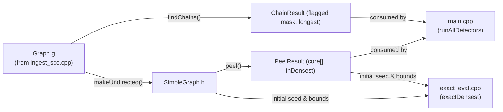

# Learning Guide: `chains_peeling.cpp` (Pass-Through Chains, $k$-Core & Greedy Peeling)

> **Role in the Pipeline:** Layering & Dense-Group Layer (Layer 3 of 4, Jeeban Jyoti Patra). Detects **Pass-Through Chains** via Dynamic Programming on a DAG, projects to a simple undirected graph $H$, and computes **$k$-core decomposition** and **greedy densest subgraphs** via priority queue peeling.

---

## Part 1: The Problem & How We Tackled It (Project Overview)

### 1.1 What Problem We Took On
Detecting layering walks and tightly-knit collusive groups:
1. **Pass-Through Chains (Layering):** A sequence of $\ge L$ transfers where an intermediary quickly forwards almost all received funds to the next account within delay $D$ and tolerance $\varepsilon$.
2. **Dense Subgraphs & $k$-Cores:** Collusive rings of accounts that trade heavily with one another, forming dense structures in the undirected transaction network.

### 1.2 How We Tackled It
- **Longest Path in a DAG via Dynamic Programming:** Because transfers can only be forwarded chronologically into the future, the "follows" relation is acyclic.
- **Degree Peeling with a Priority Queue:** Iteratively removing the lowest-degree vertex computes $k$-core numbers and yields a $\frac{1}{2}$-approximation to the densest subgraph problem.

---

## Part 2: Deep Dive into `chains_peeling.cpp`

### 2.1 Pass-Through Chains via Dynamic Programming
- **The "Follows" Relation (`follows`):** Transfer $f$ follows $e$ if:
  1. $f$ leaves the account $e$ entered (`y.from == x.to`).
  2. $f$ occurs later than $e$ ($f > e$ in chronological index).
  3. Delay is bounded: $t(f) - t(e) \le \text{maxDelay}$.
  4. Amount forwarded satisfies: $(1 - \varepsilon) \cdot \text{amount}(e) \le \text{amount}(f) \le \text{amount}(e)$.
- **Two-Pass Dynamic Programming (`findChains`):**
  - **Forward Pass:** Compute `before[f]`, the length of the longest chain ending at transfer $f$, by checking incoming transfers at `f.from` within $[t(f) - D, t(f)]$.
  - **Backward Pass:** Compute `after[e]`, the length of the longest chain starting at transfer $e$, by checking outgoing transfers from `e.to` within $[t(e), t(e) + D]$.
  - **Chain Length Through $e$:** The longest chain passing through transfer $e$ has length `before[e] + after[e] - 1`. If this exceeds $L$, $e$ is flagged.

### 2.2 Undirected Projection (`makeUndirected`)
- Takes the multigraph $G$ and extracts unique pairs $\{u, v\}$, ignoring orientation and dropping duplicate edges.
- Stores the result in `SimpleGraph h` with adjacency lists `adj`.

### 2.3 $k$-Core Decomposition and Greedy Peeling (`peel`)
- **Density Definition:** For a vertex set $S$, density is $\rho(S) = \frac{|E(S)|}{|S|}$.
- **Priority Queue Peeling:**
  - Maintains accounts in a `std::set<pair<int, int>>` sorted by `(degree, account)`.
  - While vertices remain, pop the vertex $v$ with minimal current degree.
  - Set `core[v] = max(level, deg[v])`.
  - Decrement degrees of all active neighbors of $v$, updating the priority queue.
  - Track the remaining subgraph's density $\frac{\text{edgesLeft}}{\text{verticesLeft}}$ using cross-multiplication:
    $$\text{edgesLeft} \cdot \text{bestVertices} > \text{bestEdges} \cdot \text{verticesLeft}$$
- **Approximation Guarantee:** As proven by Charikar, greedy peeling is guaranteed to produce a subgraph with density at least $\frac{1}{2} \rho^*$ of the optimal densest subgraph.

### 2.4 Tests (`testChainsPeeling`)
- **Chain Tests:** Validates a 3-hop transfer chain with 10-second delays; tests delay boundaries, amount fee tolerances (0.02 vs 0.10 vs 0.60), and longest chain recovery.
- **Peeling Tests:** Evaluates a 4-clique with a tail $\{D, E, F\}$, confirming max core $k=3$, core numbers for peripheral nodes, and greedy identification of the clique as the densest set.

---

## Part 3: Inter-Module Dependencies & Data Flow

