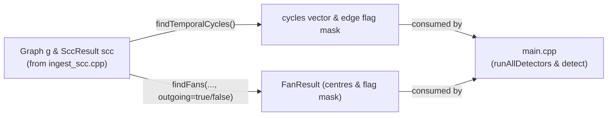

# Learning Guide: `cycles_fan.cpp` (Temporal Cycles & Fan-Out / Fan-In)

> **Role in the Pipeline:** Pattern Detector Layer 1 (Layer 2 of 4, Debtanu Das). Detects **Round-Tripping** (bounded-length temporal cycles) and **Smurfing** (fan-out and fan-in bursts) directly on the time-sorted directed graph produced by `ingest_scc.cpp`.

---

## Part 1: The Problem & How We Tackled It (Project Overview)

### 1.1 What Problem We Took On
Detecting round-tripping and smurfing structures in financial transfer streams:
1. **Round-Tripping (Temporal Cycles):** Money leaves an account and circulates through intermediaries back to the origin within window $W$ across $2 \le k \le K$ hops with chronological timestamps.
2. **Smurfing — Fan-Out:** An account disperses money to $\ge k$ distinct accounts within window $W$.
3. **Smurfing — Fan-In:** An account aggregates funds from $\ge k$ distinct accounts within window $W$.

### 1.2 How We Tackled It
- **Depth-First Search with Backtracking:** Explores candidate cycle paths up to length $K$, pruning branches early using SCC components and timestamp bounds.
- **Two-Pointer Sliding Window:** Scans time-sorted adjacency lists to count distinct counterparties in $O(n + m)$ linear time.

---

## Part 2: Deep Dive into `cycles_fan.cpp`

### 2.1 How It Fits Into the Project
`cycles_fan.cpp` implements the first three pattern detectors: **Temporal Cycles**, **Fan-Out**, and **Fan-In**. It feeds into the evaluation pipeline and CLI reporting in `main.cpp`.

### 2.2 Bounded-Length Temporal Cycles (Round-Tripping)
- **Functions:** `findTemporalCycles`, `extendPath`, `edgesOnCycles`.
- **Definition:** A sequence of edges $e_1, \dots, e_k$ ($2 \le k \le K$) such that:
  1. Consecutive edges meet head-to-tail, and the last edge returns to the start account.
  2. Accounts are distinct (simple cycle).
  3. Timestamps are non-decreasing: $t(e_1) \le t(e_2) \le \dots \le t(e_k)$.
  4. Total time satisfies $t(e_k) - t(e_1) \le W$.
  5. The first edge index is the smallest among all edges in the cycle, ensuring each cycle is reported exactly once without redundant cyclic rotations.
- **DFS with Backtracking (`extendPath`):**
  - For each edge $e_1$ as a candidate starting hop:
    - Sets `deadline = e_1.time + window`.
    - Skips edges between different SCCs (`scc.comp[from] != scc.comp[to]`).
    - Recurses forward using binary search (`firstAtOrAfter`) to find subsequent hops with $t \ge \text{lastTime}$.
    - Backtracks (`onPath[u] = 0`, `path.pop_back()`) to explore alternative paths.

### 2.3 Fan-Out / Fan-In (Smurfing) via Two-Pointer Window
- **Structs & Functions:** `FanResult`, `findFans`.
- **Algorithm:**
  - For each account $u$, examine its sorted adjacency list (`outEdges` for fan-out, `inEdges` for fan-in).
  - Maintain a sliding window `[left..right]` of transfers spanning at most $W$ seconds.
  - Advance `right`: increment `count[partner]`. If count transitions $0 \to 1$, increment `distinct`.
  - While `t(right) - t(left) > window`: decrement `count[oldPartner]`. If count hits 0, decrement `distinct`, and advance `left`.
  - When `distinct >= minPartners`, flag all transfers in the window.
- **Complexity:** Every transfer is added and removed at most once, giving $O(n + m)$ overall runtime.

### 2.4 Tests (`testCyclesFan`)
- **Cycle Tests:** Tests a 3-hop cycle with a 20-second span; verifies window boundaries (fails at 19s, passes at 20s), hop limits ($K=2$ vs $K=3$), and multi-rotation deduplication.
- **Fan Tests:** Tests hub $H$ sending to 4 distinct recipients within 30 seconds; verifies fan-out flags and threshold parameters.

---

## Part 3: Inter-Module Dependencies & Data Flow

