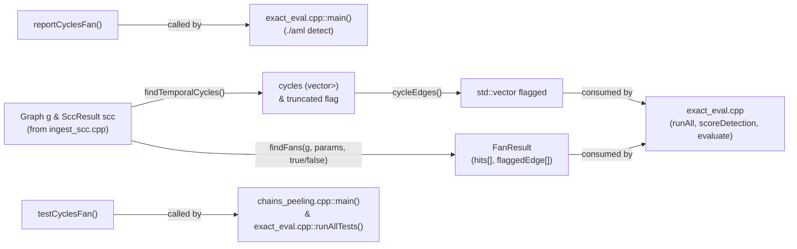

# Learning Guide: `cycles_fan.cpp` (Temporal Cycles & Fan-Out / Fan-In)

> **Role in the Pipeline:** Pattern Detector Layer 1 (Layer 2 of 4). Detects **Round-Tripping** (bounded-length temporal cycles) and **Smurfing** (fan-out and fan-in bursts) directly on the time-sorted directed multigraph produced by `ingest_scc.cpp`.

---

## Part 1: The Problem & How We Tackled It (Project Overview)

### 1.1 What Problem We Took On
Financial institutions record massive streams of bank transfers. Money launderers hide illicit funds inside ordinary payment traffic by structuring transfers into recognizable topological and temporal patterns. The target input is the 11-column **IBM Synthetic AML Transaction Dataset** (`HI-Small_Trans.csv`), where every row records:

```text
Timestamp, From Bank, Account, To Bank, Account, Amount Received, Receiving Currency, Amount Paid, Payment Currency, Payment Format, Is Laundering
```

Our goal is to **flag individual transfers (`Edge`s) that participate in money-laundering rings**, and evaluate detection quality (Precision, Recall, $F_1$) and scaling against the ground-truth `Is Laundering` label across **five recurring laundering typologies**:

1. **Round-Tripping (Temporal Cycles):** Funds leave an account and loop back to the same origin within $W$ seconds across $2 \le k \le K$ hops with non-decreasing timestamps.
2. **Smurfing — Fan-Out:** A single source account splits money across $\ge k$ distinct recipient accounts within a short window $W$.
3. **Smurfing — Fan-In:** $\ge k$ distinct sender accounts funnel funds into a single collector account within window $W$.
4. **Layering (Pass-Through Chains):** A sequence of $\ge L$ consecutive transfers where each intermediary forwards almost all ($1 - \varepsilon$ to $100\%$) of the amount it received within delay $D$.
5. **Collusive Rings (Dense Subgraphs / $k$-Cores):** Tightly knit groups of accounts transacting heavily among themselves, forming subgraphs of unusually high edge density $\rho(S) = |E(S)| / |S|$.

### 1.2 How We Tackled It
- **Pure Deterministic Graph Theory (No Machine Learning):** Rather than training black-box models or clustering heuristics, every laundering structure is given a **formal mathematical definition**, an **exact or provably bounded graph algorithm**, a **correctness proof / invariant**, and a **time complexity bound**.
- **Dual Graph Representation:**
  - A **directed temporal multigraph** $G = (V, E)$ keeps parallel transfers (repeated transfers between the same pair carry signal) and self-loops (tracked and skipped explicitly by detectors), with edges sorted chronologically.
  - A **simple undirected projection** $H$ collapses parallel/reverse transfers and removes self-loops for dense-subgraph and $k$-core optimization.
- **Four-File Cumulative `#include` Chain:** The system is one C++17 standard-library-only program split into four layered modules:
  ```text
  ingest_scc.cpp  ──▶  cycles_fan.cpp  ──▶  chains_peeling.cpp  ──▶  exact_eval.cpp (main CLI)
  ```
  Preprocessor guards (`AML_INCLUDED`, `AML_STANDALONE_<MODULE>`) allow each file to compile standalone and run cumulative self-tests for itself and earlier layers, while compiling [exact_eval.cpp](../src/exact_eval.cpp) builds the unified `./aml` CLI (`test`, `generate`, `detect`, `evaluate`).
- **Tested Before Trusted:** Every fast algorithm is verified against an independent brute-force oracle across **14,400 random graphs** (72 total `CHECK` assertions, 0 failures) plus hand-crafted boundary tests.

---

## Part 2: Deep Dive into `cycles_fan.cpp`

### 2.1 How It Fits Into the Project
[cycles_fan.cpp](../src/cycles_fan.cpp) implements **three of the five laundering detectors**: **Temporal Cycles**, **Fan-Out**, and **Fan-In**. It relies on `ingest_scc.cpp`'s time-sorted `Graph` and `SccResult` to search efficiently without missing a single qualifying pattern, and exports edge-level boolean flag masks (`std::vector<char>`) consumed by the evaluation harness and CLI.

### 2.2 Bounded-Length Temporal Cycles (Round-Tripping)
- **Structs & Functions:** `CycleParams` (`maxLength = 6`, `window = 7 * 86400LL`, `maxCycles = 0`), `CycleFinder`, `findTemporalCycles`, `cycleEdges` ([cycles_fan.cpp](../src/cycles_fan.cpp#L21-L109)).
- **Formal Definition (5 Conditions):** A temporal cycle is a sequence of edge indices $e_1, \dots, e_k$ ($2 \le k \le K$) such that:
  1. Consecutive edges meet head-to-tail, and $\text{head}(e_k) = \text{tail}(e_1)$ (closed loop).
  2. The $k$ tail vertices are distinct (simple cycle; no self-loops).
  3. Timestamps are non-decreasing: $t(e_1) \le t(e_2) \le \dots \le t(e_k)$.
  4. Total elapsed time satisfies $t(e_k) - t(e_1) \le W$.
  5. **$e_1$ has the smallest edge index** among $e_1, \dots, e_k$. *(Why? If all edges in a 3-cycle have the same timestamp, the cycle could otherwise be rotated and reported 3 times. Condition 5 selects a unique canonical root.)*
- **How `CycleFinder` Works:**
  1. Iterates through each edge $r = (s, v)$ (`rootIndex = i`). Immediately skips self-loops (`e.from == e.to`) and edges crossing SCC boundaries (`scc.comp[e.from] != scc.comp[e.to]`).
  2. Sets `deadline = e.timestamp + params.window` and runs bounded DFS `extend(u, lastTime)` from `v`.
  3. At vertex `u`, calls `g.firstOutAtOrAfter(u, lastTime)` (binary search in $O(\log \deg(u))$) to jump directly to edges with $t(f) \ge \tau$.
  4. Scans forward until `e.timestamp > deadline` (stopping early via the Time-Sorted Adjacency Invariant).
  5. Skips `idx <= rootIndex` (Condition 5). If `e.to == start`, records the closed cycle; otherwise recurses only if `e.to` is not already `onPath`, stays inside `scc.comp[start]`, and `(int)path.size() + 1 < params.maxLength`.
- **Complexity & Guarantees:** Exact (every temporal cycle is output **once**, proved by induction on $e_1 \dots e_k$). Complexity is $O(m \cdot d^{K-1})$, where $d$ is the maximum out-degree inside one window of length $W$. That exponential dependence on $K$ is why $K$ is bounded (default `6`, plus an optional `maxCycles` safety cap of `1,000,000` in the CLI).

### 2.3 Fan-Out / Fan-In (Smurfing)
- **Structs & Functions:** `FanParams` (`minDistinct = 5`, `window = 86400LL`), `FanHit`, `FanResult`, `findFans` ([cycles_fan.cpp](../src/cycles_fan.cpp#L112-L176)).
- **Formal Definition:** Given direction (`outgoing = true` for fan-out over `outAdj[u]`, `false` for fan-in over `inAdj[u]`), a **qualifying window** of vertex $u$ is a consecutive slice `[left..right]` of $u$'s adjacency list spanning at most $W$ seconds ($t(\text{right}) - t(\text{left}) \le W$) that touches at least $k$ distinct counterparties (excluding self-loops). An edge is flagged iff it belongs to at least one qualifying window.
- **How the Two-Pointer Sliding Window Works:**
  - For each vertex $u$ with `deg >= params.minDistinct`, advances `right` from `0` to `deg - 1`:
    - Increments `count[other]`; if it goes from `0` to `1` (and `other != u`), increments `distinct`.
    - Advances `left` while `t(right) - t(left) > window`, decrementing `count[oldOther]` and `distinct` when a counterparty drops to zero.
    - When `distinct >= params.minDistinct`, marks edges from `std::max(left, markedUpTo + 1)` through `right` and updates `markedUpTo = right`.
    - Tracks the peak `bestDistinct` window in `FanHit`.
  - After the loop, resets `count[other] = 0` only for `i = left..deg - 1` (edges `< left` were already decremented to `0`), avoiding $O(n)$ cleanup per vertex.
- **Complexity & Exactness:** For any fixed `right`, `left` sits at the earliest position still within `window`, giving the **longest** valid window ending at `right`. Because distinct counterparty counts only increase when a window expands, `right` participates in *some* qualifying window iff this maximal window qualifies. Each pointer advances at most $\deg(u)$ times, yielding **$O(n + m)$ total time**.

### 2.4 Self-Tests (`testCyclesFan`)
([cycles_fan.cpp](../src/cycles_fan.cpp#L209-L381))
1. **Hand-made Cycle Graph:** Tests a 3-cycle (`10s -> 20s -> 30s`) plus a late parallel edge (`500s`) across boundary parameters (`W=100`, `W=480`, `K=2`, `W=19` vs `W=20`).
2. **400 Random Graphs vs `bruteCycles`:** Exhaustively enumerates every ordered sequence of $\le K$ distinct edges and checks all 5 definition conditions directly without SCC or binary-search pruning (`345` cycles matched, 0 duplicates, 0 mismatches).
3. **Hand-made Fan Graph:** Hub `H` sending to `R1..R4` plus parallel edge to `R1` and late edge to `R5` two days later, and `R1..R4 -> S`, checking boundary parameters (`minDistinct = 4 vs 5`, `window = 29 vs 3600 vs 3 days`).
4. **2,000 Random Graphs vs `bruteFans`:** Checks all $(i, j)$ pairs in each adjacency list (`6,870` fan centres matched, 0 mismatches).

**Standalone build & test (runs `testIngestScc()` + `testCyclesFan()`):**
```bash
clang++ -std=c++17 -O2 cycles_fan.cpp -o cycles_fan && ./cycles_fan
```

---

## Part 3: Inter-File Dependencies, Outputs & Data Flow

### 3.1 Upstream Dependencies (What `cycles_fan.cpp` Takes from `ingest_scc.cpp`)
`cycles_fan.cpp` defines `AML_INCLUDED` and includes [ingest_scc.cpp](../src/ingest_scc.cpp#L10-L15):
- **`Graph`, `Edge`:** Reads `g.n`, `g.edges`, `g.outAdj`, `g.inAdj`, and relies critically on the **Time-Sorted Adjacency Invariant** so `left`/`right` pointers and `deadline` early-breaks are valid.
- **`Graph::firstOutAtOrAfter(u, lastTime)`:** Used inside `CycleFinder::extend()` to skip edges earlier than the current path timestamp in $O(\log \deg)$.
- **`SccResult` (`tarjanScc` output):** Used inside `CycleFinder::run()` and `CycleFinder::extend()` to prune edges connecting vertices in different SCCs (`scc.comp[u] != scc.comp[v]`).
- **Utilities & Test Framework:** `countFlagged`, `secondsSince`, `CHECK`, `checksFailed`, and `testIngestScc()` (called in standalone `main()`).

### 3.2 Outputs Produced & Where They Go



*(Note: [chains_peeling.cpp](../src/chains_peeling.cpp) sits immediately downstream in the `#include` chain solely so all 4 files form a single linear chain; it relies on `ingest_scc.cpp`'s symbols passing through `cycles_fan.cpp`, while the cycle and fan detector outputs flow directly to [exact_eval.cpp](../src/exact_eval.cpp).)*

| Output / Symbol Exported | What It Represents | Exact Downstream Consumer | Where It Goes / How It Is Used |
| :--- | :--- | :--- | :--- |
| `CycleParams`, `findTemporalCycles`, `cycleEdges` | List of canonical temporal cycles + per-edge flag mask (`std::vector<char>`) | [exact_eval.cpp](../src/exact_eval.cpp) (`Params`, `runAll`) | Populates the `"Temporal cycles"` `Detection` entry and contributes to `"Union of pattern detectors"` |
| `FanParams`, `FanHit`, `FanResult`, `findFans` | Flagged hub vertices + per-edge flag mask (`flaggedEdge`) | [exact_eval.cpp](../src/exact_eval.cpp) (`Params`, `runAll`) | Populates `"Fan-out"` (`outgoing=true`) and `"Fan-in"` (`outgoing=false`) `Detection` entries and the pattern union |
| `reportCyclesFan` | Formatted console report section | [exact_eval.cpp](../src/exact_eval.cpp) (`main`) | Prints `== Temporal cycles and fan-out / fan-in ==` during `./aml detect` |
| `testCyclesFan` | Boolean self-test runner | [chains_peeling.cpp](../src/chains_peeling.cpp) (`main`)<br>[exact_eval.cpp](../src/exact_eval.cpp) (`runAllTests`) | Runs all cycle and fan unit/fuzz tests (`[cycles_fan] ... PASS`) |
