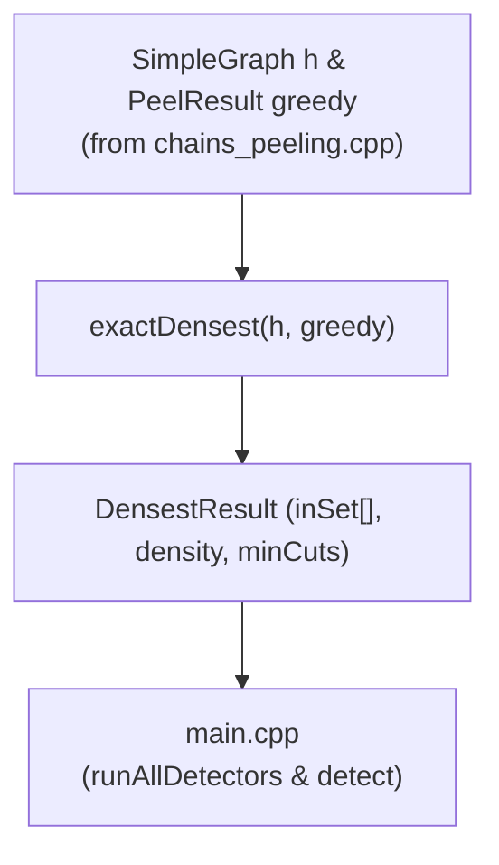

# Learning Guide: `exact_eval.cpp` (Edmonds-Karp Max-Flow, Exact Densest Subgraph & Evaluation)

> **Role in the Pipeline:** Exact Optimizer & Evaluator (Layer 4 of 4, Shatadeep De). Implements the **Edmonds-Karp algorithm** for maximum flow, solves the **Exact Densest Subgraph** problem using Goldberg's min-cut reduction, and provides precision/recall scoring metrics.

---

## Part 1: The Problem & How We Tackled It (Project Overview)

### 1.1 What Problem We Took On
Finding the mathematically optimal densest subgraph:
- Greedy degree peeling yields a fast $\frac{1}{2}$-approximation.
- For high-stakes forensic investigation, we seek the exact subset $S \subseteq V$ that maximizes $\rho(S) = \frac{|E(S)|}{|S|}$.

### 1.2 How We Tackled It
- **Edmonds-Karp Algorithm:** Computes maximum flow via shortest augmenting paths using standard Breadth-First Search (BFS).
- **Goldberg's Min-Cut Reduction:** Formulates the decision question *"Does there exist a subgraph with density $> \frac{p}{q}$?"* as an $s$-$t$ minimum cut problem.
- **$k$-Core Pruning:** The optimal densest subgraph has minimum internal degree $\ge \lceil \rho^* \rceil \ge \lceil \rho_{\text{greedy}} \rceil$. Restricting the flow network to this core dramatically shrinks the graph from 515,000 accounts to just 862 accounts on the IBM dataset.

---

## Part 2: Deep Dive into `exact_eval.cpp`

### 2.1 Edmonds-Karp Maximum Flow (`MaxFlow`)
- **Structure:**
  - Maintains `arcs` containing directed residual edges `to` and `cap`.
  - For each forward arc with index $i$, the reverse residual arc is stored at index $i \oplus 1$.
- **Augmentation via BFS:**
  - In each phase, a BFS from source $s$ finds the path to sink $t$ with the fewest hops.
  - Pushes bottleneck capacity $\Delta = \min_{(u, v) \in \text{path}} c_f(u, v)$ along the path.
  - Updates residual capacities: $c_f(u, v) \mathrel{-}= \Delta$ and $c_f(v, u) \mathrel{+}= \Delta$.
  - Terminates when sink $t$ is unreachable in the residual network.
- **Minimum Cut Extraction (`sourceSide`):**
  - Run a BFS from $s$ traversing only arcs with positive residual capacity ($c_f > 0$).
  - All reachable vertices form the source partition $S$ of an exact minimum $s$-$t$ cut (Max-Flow Min-Cut Theorem).

### 2.2 Exact Densest Subgraph (`exactDensest`)
- **Goldberg's Construction:** Given a candidate density $\frac{p}{q}$, construct a flow network on $\{s, t\} \cup V$:
  - $s \to v$ with capacity $m \cdot q$
  - $v \to t$ with capacity $m \cdot q + 2p - \text{deg}(v) \cdot q$
  - $u \leftrightarrow v$ with capacity $q$ for each undirected edge $\{u, v\}$
- **Cut Property:** Any cut separating $\{s\} \cup S$ from $\{t\} \cup (V \setminus S)$ has capacity:
  $$C(S) = m \cdot n \cdot q + 2\bigl(p|S| - q|E(S)|\bigr)$$
  Minimizing cut capacity directly maximizes $q|E(S)| - p|S|$. If the source side yields $q|E(S)| - p|S| > 0$, then $S$ has density strictly greater than $\frac{p}{q}$.
- **Iterative Improvement:**
  - Start with $\frac{p}{q} = \rho_{\text{greedy}}$.
  - Compute minimum cut; if the cut identifies a denser set $S$, update $p \leftarrow |E(S)|$ and $q \leftarrow |S|$.
  - Repeat until no strictly denser set is found (typically completes in 1 to 3 min-cuts).

### 2.3 Evaluation Metrics (`score`)
- **Metrics Computed:**
  $$\text{Precision} = \frac{\text{True Positives}}{\text{Flagged}}, \quad \text{Recall} = \frac{\text{True Positives}}{\text{Total Laundering}}, \quad F_1 = \frac{2 \cdot P \cdot R}{P + R}$$
- **Prefix Scaling:** Subsets of the first $25\%, 50\%, 75\%, 100\%$ of transfers are evaluated to measure execution scaling.

### 2.4 Tests (`testExactEval`)
- **Flow Tests:** Classic 6-vertex flow network (CLRS textbook Figure 26.1) with capacities up to 20, confirming maximum flow equals 23 and source-side cut matches $\{s, 1, 2, 4\}$.
- **Densest Subgraph Tests:** A 4-clique with a tail, and a bipartite ring $K_{2,6}$ alongside three disjoint triangles, verifying exact identification of the denser component.
- **Metric Checks:** Verifies precision, recall, and F1 calculations.

---

## Part 3: Inter-Module Dependencies & Data Flow

