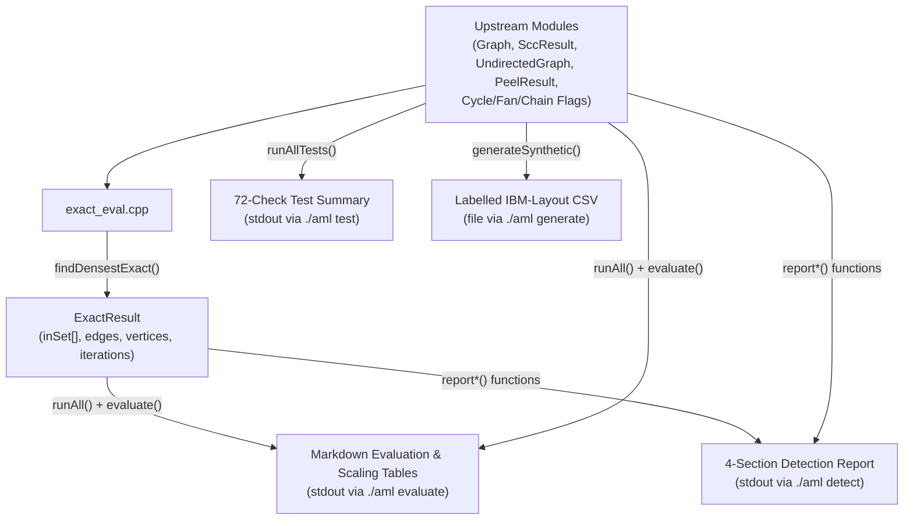

# Learning Guide: `exact_eval.cpp` (Dinic Max-Flow, Exact Densest Subgraph & CLI Harness)

> **Role in the Pipeline:** Exact Optimizer, Evaluator & Orchestrator (Layer 4 of 4). Solves the **Exact Densest Subgraph** problem via Goldberg's minimum-cut reduction on top of Dinic's iterative maximum-flow algorithm, orchestrates all detectors in `runAll()`, scores Precision/Recall/$F_1$ and prefix scaling in `evaluate()`, and implements the `./aml` CLI (`main()`).

---

## Part 1: The Problem & How We Tackled It (Project Overview)

### 1.1 What Problem We Took On
Financial institutions record massive streams of bank transfers. Money launderers hide illicit funds inside ordinary payment traffic by structuring transfers into recognizable topological and temporal patterns. The target input is the 11-column **IBM Synthetic AML Transaction Dataset** (`HI-Small_Trans.csv`), where every row records:

```text
Timestamp, From Bank, Account, To Bank, Account, Amount Received, Receiving Currency, Amount Paid, Payment Currency, Payment Format, Is Laundering
```

Our goal is to **flag individual transfers (`Edge`s) that participate in money-laundering rings**, and evaluate detection quality (Precision, Recall, $F_1$) and scaling against the ground-truth `Is Laundering` label across **five recurring laundering typologies**:

1. **Round-Tripping (Temporal Cycles):** Funds leave an account and loop back to the same origin within $W$ seconds across $2 \le k \le K$ hops with non-decreasing timestamps.
2. **Smurfing — Fan-Out:** A single source account splits money across $\ge k$ distinct recipient accounts within a short window $W$.
3. **Smurfing — Fan-In:** $\ge k$ distinct sender accounts funnel funds into a single collector account within window $W$.
4. **Layering (Pass-Through Chains):** A sequence of $\ge L$ consecutive transfers where each intermediary forwards almost all ($1 - \varepsilon$ to $100\%$) of the amount it received within delay $D$.
5. **Collusive Rings (Dense Subgraphs / $k$-Cores):** Tightly knit groups of accounts transacting heavily among themselves, forming subgraphs of unusually high edge density $\rho(S) = |E(S)| / |S|$.

### 1.2 How We Tackled It
- **Pure Deterministic Graph Theory (No Machine Learning):** Rather than training black-box models or clustering heuristics, every laundering structure is given a **formal mathematical definition**, an **exact or provably bounded graph algorithm**, a **correctness proof / invariant**, and a **time complexity bound**.
- **Dual Graph Representation:**
  - A **directed temporal multigraph** $G = (V, E)$ keeps parallel transfers (repeated transfers between the same pair carry signal) and self-loops (tracked and skipped explicitly by detectors), with edges sorted chronologically.
  - A **simple undirected projection** $H$ collapses parallel/reverse transfers and removes self-loops for dense-subgraph and $k$-core optimization.
- **Four-File Cumulative `#include` Chain:** The system is one C++17 standard-library-only program split into four layered modules:
  ```text
  ingest_scc.cpp  ──▶  cycles_fan.cpp  ──▶  chains_peeling.cpp  ──▶  exact_eval.cpp (main CLI)
  ```
  Preprocessor guards (`AML_INCLUDED`, `AML_STANDALONE_<MODULE>`) allow each file to compile standalone and run cumulative self-tests for itself and earlier layers, while compiling [exact_eval.cpp](../src/exact_eval.cpp) builds the unified `./aml` CLI (`test`, `generate`, `detect`, `evaluate`).
- **Tested Before Trusted:** Every fast algorithm is verified against an independent brute-force oracle across **14,400 random graphs** (72 total `CHECK` assertions, 0 failures) plus hand-crafted boundary tests.

---

## Part 2: Deep Dive into `exact_eval.cpp`

### 2.1 How It Fits Into the Project
[exact_eval.cpp](../src/exact_eval.cpp) sits at the **top of the chain**. It upgrades the $\frac{1}{2}$-approximate greedy densest subgraph from [chains_peeling.cpp](../src/chains_peeling.cpp) to the **provably optimal exact densest subgraph**, combines every detector from all 4 files into a single benchmarkable pipeline, and serves as the user-facing `./aml` executable.

### 2.2 Iterative Dinic's Maximum Flow (`MaxFlow`)
([exact_eval.cpp](../src/exact_eval.cpp#L36-L139))
- Stores forward/backward residual arcs at adjacent indices (`i` and `i ^ 1`) using 64-bit `long long` capacities.
- **`buildLevels(s, t)`:** Iterative BFS constructing the shortest-path level graph `level[]`.
- **`blockingFlow(s, t)`:** Fully **iterative** DFS using an explicit `path` of arc IDs and current-arc pointers `it[u]`:
  - When reaching `t`, computes the bottleneck `push`, updates forward/backward capacities along `path`, and retreats directly back to the tail of the first saturated arc.
  - Marks dead-end vertices with `level[u] = -1` so they are never revisited in the current phase.
  - Why iterative? Just like `tarjanScc`, avoids call-stack overflow on deep residual graphs.
- **`sourceSide(s)`:** After `run(s, t)` terminates, runs a BFS over positive residual capacity arcs (`cap > 0`) from `s`. By the Max-Flow Min-Cut Theorem, the reachable vertices form the source side of a minimum $s$-$t$ cut.
- **Complexity:** $O(V^2 E)$ worst-case with integer capacities.

### 2.3 Exact Densest Subgraph via Min-Cut & Dinkelbach Iteration (`findDensestExact`)
([exact_eval.cpp](../src/exact_eval.cpp#L143-L235))

Given a rational density guess $p/q$ ($p \ge 0, q \ge 1$ reduced by `gcdLL`), Goldberg's flow network $N(p, q)$ on $V \cup \{s, t\}$ adds:
- $s \to v$ with capacity $mq$ for every vertex $v$
- $v \to t$ with capacity $mq + 2p - \deg(v)q$ for every vertex $v$ (non-negative since $\deg(v) \le m$)
- $u \leftrightarrow v$ with capacity $q$ in both directions for every undirected edge $\{u, v\}$

**Why This Solves the Decision Problem (Cut Capacity Lemma & Theorem):**
For any subset $S \subseteq V$, three types of arcs cross the cut $(\{s\} \cup S, \{t\} \cup (V \setminus S))$:
- $s \to v$ for $v \notin S$: contributes $mq(n - |S|)$.
- $v \to t$ for $v \in S$: contributes $mq|S| + 2p|S| - q \sum_{v \in S} \deg(v)$.
- $u \to v$ leaving $S$: contributes $q \cdot \partial(S)$, where $\partial(S)$ is the boundary edge count.

Using the identity $\sum_{v \in S} \deg(v) = 2|E(S)| + \partial(S)$, the boundary terms cancel identically, giving:
$$c(S) = mnq + 2\bigl(p|S| - q|E(S)|\bigr)$$
Therefore, minimizing cut capacity minimizes $p|S| - q|E(S)|$. The empty set $S = \emptyset$ gives $0$, whereas a non-empty set $S$ has negative second term iff $|E(S)| / |S| > p/q$. Thus, the source side $S$ of a minimum cut detects a strictly denser subgraph whenever one exists, or certifies optimality!

**Two Major Optimizations Built In:**
1. **Core Pruning:** Since every vertex in an optimal set $S^*$ has at least $\lceil \rho^* \rceil \ge \lceil \rho_{\text{greedy}} \rceil$ neighbors inside $S^*$, `findDensestExact` restricts the network to vertices with `greedy.coreNumber[v] >= ceil(greedy.density())`. This dramatically shrinks `networkVertices` and `networkEdges` (e.g., to just **8 vertices and 28 edges** on [synth.csv](../data/synth.csv)).
2. **Dinkelbach Iteration (No Binary Search):** Instead of binary-searching over $p/q$, `findDensestExact` starts directly at $p/q = \text{greedy.bestEdges} / \text{greedy.bestVertices}$, computes a min-cut, and if `q * setEdges - p * setVertices > 0`, replaces $p/q$ by the reduced fraction `setEdges / setVertices` and repeats. Because exact densities lie in $\{a/b : 0 \le a \le m, 1 \le b \le n\}$ and integer arithmetic avoids rounding errors, iteration always terminates cleanly (typically in **1 to 2 min-cuts**).

### 2.4 Evaluation Harness & CLI (`runAll`, `evaluate`, `main`)
([exact_eval.cpp](../src/exact_eval.cpp#L239-L381), [`L545-L603`](../src/exact_eval.cpp#L545-L603))
- **`parseParams`:** Reads positional CLI overrides `[K Whours maxCycles fanMin fanWhours chainMin chainDhours chainEps]` (defaults: `6 168 1000000 5 24 3 24 0.10`).
- **`runAll`:** Runs all 7 individual detectors (`Temporal cycles`, `Fan-out`, `Fan-in`, `Pass-through chains`, `Max k-core`, `Greedy densest`, `Exact densest`) plus `"Union of pattern detectors"` (bitwise OR of the first 4 pattern detectors; dense sets are scored separately because they flag whole regions).
- **`evaluate`:** Computes per-transfer Precision, Recall, $F_1$ (excluding self-loops from the positive denominator since no detector flags self-loops), and measures runtime scaling on the first `25%`, `50%`, `75%`, and `100%` of transfers via `prefixGraph`.
- **`main`:** Dispatches four CLI subcommands:
  - `./aml test`: Runs `runAllTests()` across all 4 modules.
  - `./aml generate <out.csv> [accounts] [background] [seed]`: Generates a synthetic dataset.
  - `./aml detect <file.csv> [params...]`: Prints the 4-section terminal report (`reportIngestScc`, `reportCyclesFan`, `reportChainsPeeling`, `reportExactDensest`).
  - `./aml evaluate <file.csv> [params...]`: Prints Markdown evaluation and scaling tables.

### 2.5 Self-Tests (`testExactEval`)
([exact_eval.cpp](../src/exact_eval.cpp#L403-L538))
1. **2,000 Random Flow Networks:** Compares Dinic's max-flow value and `sourceSide(s)` cut capacity against brute-force enumeration of all $2^n$ $s$-$t$ cuts (`0` mismatches).
2. **Hand-made Graphs:**
   - 4-clique with tail `3-4-5` (confirms core pruning shrinks the network to 4 vertices).
   - $K_{2,6}$ (density `3/2`) alongside three disjoint triangles (density `1`), verifying `findDensestExact` picks the `8`-vertex $K_{2,6}$ subgraph.
3. **3,000 Random Graphs vs `bruteDensest`:** Tests `findDensestExact` both with and without core pruning against $2^n$ subsets (`0` mismatches; exact beat greedy on `79` graphs, using at most `2` min cuts).
4. **Evaluation Harness Checks:** Hand-verified `scoreDetection` (`precision=0.5, recall=0.5, f1=0.5`) and `prefixGraph`, plus an end-to-end synthetic run (`aml_test_e2e.csv`, 2,000 accounts, 10,000 background edges) verifying all 4 pattern detectors find true positives and their union achieves `recall > 0.5`.

**Full program build & run:**
```bash
clang++ -std=c++17 -O2 exact_eval.cpp -o aml
./aml test
```

---

## Part 3: Inter-File Dependencies, Outputs & Data Flow

### 3.1 Upstream Dependencies (What `exact_eval.cpp` Consumes)
`exact_eval.cpp` defines `AML_INCLUDED` and includes [chains_peeling.cpp](../src/chains_peeling.cpp), pulling in the entire lower stack:

| Upstream Source File | Symbols & Data Consumed | Where & Why `exact_eval.cpp` Uses Them |
| :--- | :--- | :--- |
| [ingest_scc.cpp](../src/ingest_scc.cpp) | `Graph`, `Edge`, `IngestStats`, `loadCsv`, `generateSynthetic` | `main()` loads CSVs or writes synthetic data; `prefixGraph()` slices time-ordered prefixes; `evaluate()` counts non-self-loop positives |
| [ingest_scc.cpp](../src/ingest_scc.cpp) | `SccResult`, `tarjanScc` | Called in `runAll()` and `main()` (`detect`) and passed into cycle detection |
| [ingest_scc.cpp](../src/ingest_scc.cpp) | `countFlagged`, `secondsSince`, `CHECK`, `checksRun`, `checksFailed`, `reportIngestScc`, `testIngestScc` | Used by `scoreDetection()`, `reportExactDensest()`, `runAll()`, `runAllTests()`, `testExactEval()`, and `main()` |
| [cycles_fan.cpp](../src/cycles_fan.cpp) | `CycleParams`, `findTemporalCycles`, `cycleEdges`, `FanParams`, `FanResult`, `findFans`, `reportCyclesFan`, `testCyclesFan` | `Params` bundles `CycleParams` & `FanParams`; `runAll()` collects their edge masks and timings; `main()` prints `reportCyclesFan()`; `runAllTests()` calls `testCyclesFan()` |
| [chains_peeling.cpp](../src/chains_peeling.cpp) | `ChainParams`, `ChainResult`, `findChains`, `edgesInside`, `inKCore`, `reportChainsPeeling`, `testChainsPeeling` | `Params` bundles `ChainParams`; `runAll()` collects chain/k-core/densest edge masks; `main()` receives `h` & `peeled` from `reportChainsPeeling()` and forwards them to `reportExactDensest()` |
| [chains_peeling.cpp](../src/chains_peeling.cpp) | `UndirectedGraph`, `buildUndirected`, `PeelResult`, `peel` | `findDensestExact(h, peeled)` uses `peeled.bestEdges / bestVertices` as initial $p/q$ and `peeled.coreNumber` for $\lceil \rho_{\text{greedy}} \rceil$-core pruning |
| [chains_peeling.cpp](../src/chains_peeling.cpp) | `edgesWithin`, `bruteDensest` | Reused directly inside `testExactEval()` as the exact $2^n$ brute-force ground truth for the 3,000 random densest-subgraph checks |

### 3.2 Outputs Produced & Where They Go



Because `exact_eval.cpp` is the **terminal layer** of the `#include` chain, its outputs go directly to **the user / downstream scripts** (terminal `stdout`/`stderr`, exit codes, or generated CSV files on disk):
1. **`./aml test`** $\to$ prints pass/fail lines for all 4 modules and `ALL TESTS PASSED: 72 checks, 0 failed` (exit code `0` on pass, `1` on fail).
2. **`./aml generate`** $\to$ writes an 11-column labelled CSV file to disk and prints a generation summary.
3. **`./aml detect`** $\to$ prints four sequential sections (`Ingestion and SCC`, `Temporal cycles and fan-out / fan-in`, `Pass-through chains, k-core and greedy peeling`, `Exact densest subgraph`) to `stdout`.
4. **`./aml evaluate`** $\to$ prints a Markdown dataset summary, a Precision/Recall/$F_1$/Timing table across all 8 rows (`7` detectors + `Union of pattern detectors`), and a `25% / 50% / 75% / 100%` prefix runtime scaling table to `stdout`.
