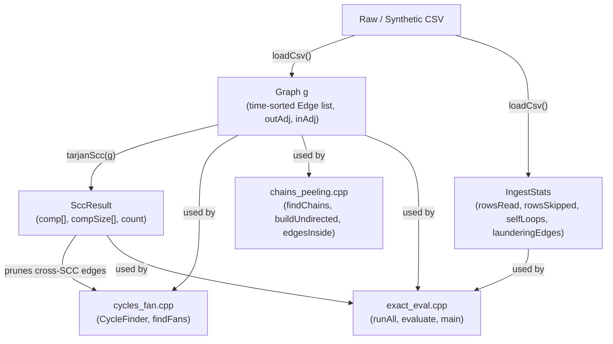

# Learning Guide: `ingest_scc.cpp` (Graph Model, Ingestion & Tarjan SCC)

> **Role in the Pipeline:** Foundation layer (Layer 1 of 4). Builds the directed temporal multigraph from raw CSV transaction logs, provides synthetic data generation, computes Strongly Connected Components (SCCs), and exports the shared data structures, utilities, and test macros used by every later file.

---

## Part 1: The Problem & How We Tackled It (Project Overview)

### 1.1 What Problem We Took On
Financial institutions record massive streams of bank transfers. Money launderers hide illicit funds inside ordinary payment traffic by structuring transfers into recognizable topological and temporal patterns. The target input is the 11-column **IBM Synthetic AML Transaction Dataset** (`HI-Small_Trans.csv`), where every row records:

```text
Timestamp, From Bank, Account, To Bank, Account, Amount Received, Receiving Currency, Amount Paid, Payment Currency, Payment Format, Is Laundering
```

Our goal is to **flag individual transfers (`Edge`s) that participate in money-laundering rings**, and evaluate detection quality (Precision, Recall, $F_1$) and scaling against the ground-truth `Is Laundering` label across **five recurring laundering typologies**:

1. **Round-Tripping (Temporal Cycles):** Funds leave an account and loop back to the same origin within $W$ seconds across $2 \le k \le K$ hops with non-decreasing timestamps.
2. **Smurfing — Fan-Out:** A single source account splits money across $\ge k$ distinct recipient accounts within a short window $W$.
3. **Smurfing — Fan-In:** $\ge k$ distinct sender accounts funnel funds into a single collector account within window $W$.
4. **Layering (Pass-Through Chains):** A sequence of $\ge L$ consecutive transfers where each intermediary forwards almost all ($1 - \varepsilon$ to $100\%$) of the amount it received within delay $D$.
5. **Collusive Rings (Dense Subgraphs / $k$-Cores):** Tightly knit groups of accounts transacting heavily among themselves, forming subgraphs of unusually high edge density $\rho(S) = |E(S)| / |S|$.

### 1.2 How We Tackled It
- **Pure Deterministic Graph Theory (No Machine Learning):** Rather than training black-box models or clustering heuristics, every laundering structure is given a **formal mathematical definition**, an **exact or provably bounded graph algorithm**, a **correctness proof / invariant**, and a **time complexity bound**.
- **Dual Graph Representation:**
  - A **directed temporal multigraph** $G = (V, E)$ keeps parallel transfers (repeated transfers between the same pair carry signal) and self-loops (tracked and skipped explicitly by detectors), with edges sorted chronologically.
  - A **simple undirected projection** $H$ collapses parallel/reverse transfers and removes self-loops for dense-subgraph and $k$-core optimization.
- **Four-File Cumulative `#include` Chain:** The system is one C++17 standard-library-only program split into four layered modules:
  ```text
  ingest_scc.cpp  ──▶  cycles_fan.cpp  ──▶  chains_peeling.cpp  ──▶  exact_eval.cpp (main CLI)
  ```
  Preprocessor guards (`AML_INCLUDED`, `AML_STANDALONE_<MODULE>`) allow each file to compile standalone and run cumulative self-tests for itself and earlier layers, while compiling [exact_eval.cpp](../src/exact_eval.cpp) builds the unified `./aml` CLI (`test`, `generate`, `detect`, `evaluate`).
- **Tested Before Trusted:** Every fast algorithm is verified against an independent brute-force oracle across **14,400 random graphs** (72 total `CHECK` assertions, 0 failures) plus hand-crafted boundary tests.

---

## Part 2: Deep Dive into `ingest_scc.cpp`

### 2.1 How It Fits Into the Project
[ingest_scc.cpp](../src/ingest_scc.cpp) is the **bottom layer** of the stack. Without it, no other file can represent accounts, read transactions, binary-search by timestamp, prune cross-component cycle searches, time algorithms, or run unit tests.

### 2.2 Core Graph Model & The Sorted-Adjacency Invariant
- **`Edge`** ([ingest_scc.cpp](../src/ingest_scc.cpp#L54-L60)): Stores `from`, `to`, `amount` (parsed from column 7, **`Amount Paid`**, rather than `Amount Received`, so amounts reflect what left the sender before currency conversion), UTC `timestamp` (seconds since `1970-01-01 00:00 UTC`), and `isLaundering`.
- **`Graph`** ([ingest_scc.cpp](../src/ingest_scc.cpp#L65-L112)):
  - **Vertex Interning (`getVertex`):** Maps `"bank:account"` strings (e.g. `"1:A"`) to dense integer IDs `0..n-1` via `accountId` (`std::unordered_map`) and `accountName`.
  - **Edge Insertion & Finalization (`addEdge`, `finalize`):** Appends edges in arbitrary CSV order, then `finalize()` calls `std::stable_sort` on `edges` by `timestamp` in $O(m \log m)$ and populates `outAdj[u]` and `inAdj[v]` in a single linear pass `i = 0..m-1`.
  - **Time-Sorted Adjacency Invariant:** Because `edges` is sorted by `timestamp` and `outAdj[u]` / `inAdj[v]` are populated in increasing `i` order, **every adjacency list holds edge indices in strictly increasing index order and non-decreasing timestamp order**.
  - **Binary Search (`firstOutAtOrAfter(u, t)`):** Uses the invariant to locate the first edge leaving `u` at or after timestamp `t` in $O(\log \deg(u))$ time.

### 2.3 Portable CSV Ingestion & Synthetic Generator
- **Portable Epoch Conversion (`daysFromCivil`, `parseTimestamp`):** ([ingest_scc.cpp](../src/ingest_scc.cpp#L135-L157)) Parses `"YYYY/MM/DD HH:MM"` strings into UTC epoch seconds using exact Gregorian calendar arithmetic (`daysFromCivil`), avoiding `timegm` which is non-standard across platforms.
- **Fault-Tolerant Loader (`loadCsv`):** ([ingest_scc.cpp](../src/ingest_scc.cpp#L175-L198)) Skips and counts malformed lines (wrong column count, bad timestamp, non-numeric or negative amount) into `IngestStats` without crashing, and calls `g.finalize()` at the end.
- **Synthetic Data Generator (`SyntheticWriter`, `generateSynthetic`):** ([ingest_scc.cpp](../src/ingest_scc.cpp#L205-L289)) Produces valid 11-column IBM-format CSV files containing uniform random background edges (`label = 0`) plus planted laundering rings (`label = 1`):
  - Cycles of $3 \dots 6$ hops (`amount *= 0.98` per hop, minutes apart)
  - Fan-outs (1 source $\to$ 8 recipients within 5 hours) and Fan-ins (8 senders $\to$ 1 collector)
  - Pass-through chains of $4 \dots 6$ hops (2–5% fee kept per hop)
  - 8-account cliques ($\binom{8}{2} = 28$ directed edges each)

### 2.4 Iterative Tarjan's SCC Algorithm
- **`SccResult` & `tarjanScc(g)`:** ([ingest_scc.cpp](../src/ingest_scc.cpp#L293-L355))
- **Why SCCs matter:** Every directed cycle—including every temporal cycle—must have all of its vertices inside a **single Strongly Connected Component**. Any transfer crossing between two different SCCs can never lie on a cycle.
- **Why Iterative:** A recursive DFS through 200,000+ accounts in a real bank graph would blow the OS call stack (`SIGSEGV`). `tarjanScc` uses an explicit `callStack` of `(vertex, outAdj_position)` pairs alongside Tarjan's component stack `st` and `onStack` bitmask.
- **Correctness Sketch:**
  - `disc[v]` records discovery order; `low[v]` tracks the earliest `disc[w]` reachable from $v$'s DFS subtree $T(v)$ to a vertex $w$ still `onStack`.
  - A vertex remains on `st` iff its SCC's root (first-discovered vertex) has not finished.
  - When `u` finishes with `low[u] == disc[u]`, `u` is the root of its SCC, and popping `st` down to `u` extracts that exact SCC in $O(n + m)$ total time.

### 2.5 Self-Tests (`testIngestScc`)
([ingest_scc.cpp](../src/ingest_scc.cpp#L386-L509))
1. **Timestamp boundaries:** Epoch `0` (`1970/01/01 00:00`), `2022/09/01 00:20`, leap day `2024/02/29 23:59`, and malformed dash-separated date rejection.
2. **Hand-made CSV ingestion:** Tests 9 rows (including out-of-order timestamps, parallel edges, a 3-cycle, a self-loop, multi-currency `Amount Paid` vs `Amount Received`, and 1 malformed row), checking degrees, handshake theorem ($\sum \text{outDeg} = \sum \text{inDeg} = |E|$), time-sorted invariant, and `firstOutAtOrAfter`.
3. **1,000 random graphs vs Floyd-Warshall (`reachability`):** Verifies `scc.comp[i] == scc.comp[j]` matches mutual reachability $(R[i][j] \land R[j][i])$ on every vertex pair.
4. **200,000-vertex deep cycle:** Proves iterative Tarjan does not overflow the stack and yields 1 SCC of size `200000`.
5. **Generator round trip:** Writes and reloads `aml_test_synth.csv` (`seed = 7`) and verifies zero skipped rows and expected planted laundering counts.

**Standalone build & test:**
```bash
clang++ -std=c++17 -O2 ingest_scc.cpp -o ingest_scc && ./ingest_scc
```

---

## Part 3: Inter-File Dependencies, Outputs & Data Flow

### 3.1 Upstream Dependencies (What `ingest_scc.cpp` Needs)
**None from the project.** `ingest_scc.cpp` depends strictly on the C++17 Standard Library (`<algorithm>`, `<chrono>`, `<cstdio>`, `<cstdlib>`, `<fstream>`, `<iostream>`, `<random>`, `<set>`, `<string>`, `<unordered_map>`, `<utility>`, `<vector>`).

Preprocessor guard behavior:
- When compiled directly, `AML_INCLUDED` is undefined, so it defines `AML_STANDALONE_INGEST_SCC`, compiling `main()` at the bottom to run `testIngestScc()`.
- When `#include`d by [cycles_fan.cpp](../src/cycles_fan.cpp), `AML_INCLUDED` is already defined, so `main()` is omitted.

### 3.2 Outputs Produced & Where They Go



| Output / Symbol Exported | Type / Kind | Exact Downstream Consumers | How the Consumer Uses It |
| :--- | :--- | :--- | :--- |
| `Edge`, `Graph`, `Graph::firstOutAtOrAfter` | Data model + binary search | [cycles_fan.cpp](../src/cycles_fan.cpp) (`CycleFinder`, `findFans`, `bruteCycles`, `bruteFans`)<br>[chains_peeling.cpp](../src/chains_peeling.cpp) (`follows`, `lowerBoundTime`, `findChains`, `buildUndirected`, `edgesInside`, `bruteChains`)<br>[exact_eval.cpp](../src/exact_eval.cpp) (`runAll`, `scoreDetection`, `prefixGraph`, `evaluate`, `main`) | Supplies all transfers, endpoints, amounts, timestamps, and $O(\log \deg)$ start positions for temporal windows |
| `SccResult`, `tarjanScc(g)` | Component mapping | [cycles_fan.cpp](../src/cycles_fan.cpp) (`CycleFinder::extend`, `CycleFinder::run`, `findTemporalCycles`, `reportCyclesFan`)<br>[exact_eval.cpp](../src/exact_eval.cpp) (`runAll`, `main`) | `CycleFinder` skips any edge `(u, v)` with `scc.comp[u] != scc.comp[v]`, eliminating non-cyclic parts of the graph |
| `IngestStats`, `loadCsv` | CSV loader + counters | [exact_eval.cpp](../src/exact_eval.cpp) (`evaluate`, `testExactEval`, `main`) | Loads dataset from disk in `detect` and `evaluate` CLI modes and prints skipped/self-loop statistics |
| `generateSynthetic` | CSV generator | [exact_eval.cpp](../src/exact_eval.cpp) (`testExactEval`, `main` in `generate` mode) | Creates synthetic benchmarks via `./aml generate` and runs end-to-end tests |
| `countFlagged` | Metric helper | [cycles_fan.cpp](../src/cycles_fan.cpp) (`reportCyclesFan`, `testCyclesFan`)<br>[chains_peeling.cpp](../src/chains_peeling.cpp) (`reportChainsPeeling`, `testChainsPeeling`)<br>[exact_eval.cpp](../src/exact_eval.cpp) (`scoreDetection`, `reportExactDensest`) | Counts total flagged edges and true positives (`isLaundering`) from any detector's `std::vector<char>` bitmask |
| `CHECK`, `checksRun`, `checksFailed`, `secondsSince` | Test & timing helpers | All downstream `.cpp` files | Unified assertion counter (`72` total across all 4 files) and wall-clock timing |
| `reportIngestScc`, `testIngestScc` | Report / test entrypoints | [cycles_fan.cpp](../src/cycles_fan.cpp) (`main`)<br>[chains_peeling.cpp](../src/chains_peeling.cpp) (`main`)<br>[exact_eval.cpp](../src/exact_eval.cpp) (`runAllTests`, `main`) | Prints the `== Ingestion and SCC ==` terminal section (`./aml detect`) and executes Module 1 tests |
