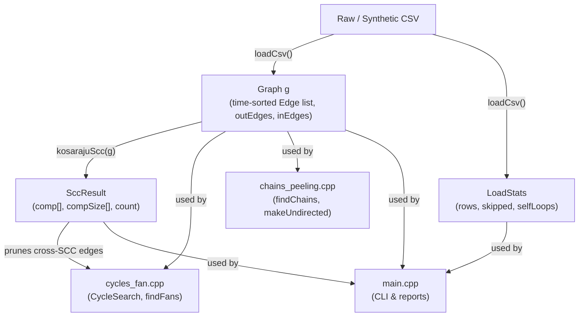

# Learning Guide: `ingest_scc.cpp` (Graph Model, Ingestion & Kosaraju SCC)

> **Role in the Pipeline:** Foundation layer (Layer 1 of 4, Adityaa Saha). Builds the directed temporal graph from raw CSV transaction logs, provides synthetic data generation, computes Strongly Connected Components (SCCs) via Kosaraju's two-pass algorithm, and exports shared graph structures and utilities.

---

## Part 1: The Problem & How We Tackled It (Project Overview)

### 1.1 What Problem We Took On
Financial institutions record massive streams of bank transfers. Money launderers hide illicit funds inside ordinary payment traffic by structuring transfers into recognizable topological and temporal patterns. The target input is the 11-column **IBM Synthetic AML Transaction Dataset** (`HI-Small_Trans.csv`), where every row records:

```text
Timestamp, From Bank, Account, To Bank, Account, Amount Received, Receiving Currency, Amount Paid, Payment Currency, Payment Format, Is Laundering
```

Our goal is to **flag individual transfers (`Edge`s) that participate in money-laundering rings**, and evaluate detection quality (Precision, Recall, $F_1$) against the ground-truth `Is Laundering` label across **five recurring laundering typologies**:

1. **Round-Tripping (Temporal Cycles):** Funds leave an account and loop back to the same origin within $W$ seconds across $2 \le k \le K$ hops with non-decreasing timestamps.
2. **Smurfing — Fan-Out:** A single source account splits money across $\ge k$ distinct recipient accounts within a short window $W$.
3. **Smurfing — Fan-In:** $\ge k$ distinct sender accounts funnel funds into a single collector account within window $W$.
4. **Layering (Pass-Through Chains):** A sequence of $\ge L$ consecutive transfers where each intermediary forwards almost all ($1 - \varepsilon$ to $100\%$) of the amount it received within delay $D$.
5. **Collusive Rings (Dense Subgraphs / $k$-Cores):** Tightly knit groups of accounts transacting heavily among themselves, forming subgraphs of unusually high edge density $\rho(S) = |E(S)| / |S|$.

### 1.2 How We Tackled It
- **Deterministic Standard Algorithms:** Rather than complex, black-box heuristics or machine learning, every structure is detected using fundamental graph algorithms taught in computer science: **DFS with backtracking**, **two-pointer sliding windows**, **DAG dynamic programming**, **Kosaraju's SCC**, **greedy degree peeling**, and **Edmonds-Karp max-flow min-cut**.
- **Dual Graph Representation:**
  - A **directed temporal graph** $G = (V, E)$ preserves all transfers sorted chronologically. Self-loops (sending to oneself) are filtered at ingestion since an account cannot ring-launder with itself.
  - A **simple undirected projection** $H$ collapses multi-edges between accounts for dense-subgraph and $k$-core detection.
- **Clean Modular Design:** Four self-contained modules included in sequential order:
  ```text
  ingest_scc.cpp  ──▶  cycles_fan.cpp  ──▶  chains_peeling.cpp  ──▶  exact_eval.cpp
                                                                            │
                                                                       main.cpp (CLI)
  ```
- **Tested with Concrete Scenarios:** Each module provides clear, hand-computable test scenarios verifying correctness without needing opaque random seeds.

---

## Part 2: Deep Dive into `ingest_scc.cpp`

### 2.1 How It Fits Into the Project
`ingest_scc.cpp` is the **bottom layer** of the stack. It parses timestamps, interns account strings to integer IDs, loads CSV transaction files, builds time-sorted adjacency lists, and divides the accounts into Strongly Connected Components (SCCs).

### 2.2 Core Graph Model & The Sorted-Adjacency Invariant
- **`Edge`**: Stores `from`, `to`, `amount` (Amount Paid), UTC `time` in epoch seconds, and ground-truth `isLaundering`.
- **`Graph`**:
  - **Vertex Interning (`getId`):** Maps `"bank:account"` strings to sequential integer IDs `0..n-1` via `unordered_map<string, int> idOf`.
  - **Graph Finalization (`build`):** Sorts `edges` by timestamp in $O(m \log m)$ using `std::stable_sort`, then populates outgoing (`outEdges`) and incoming (`inEdges`) adjacency lists.
  - **Time-Sorted Adjacency Invariant:** Because the global edge list is sorted chronologically, each vertex's `outEdges` and `inEdges` lists are automatically in chronological order.
  - **Binary Search (`firstAtOrAfter`):** Finds the first transfer in an adjacency list with `time >= t` in $O(\log \text{deg})$ time.

### 2.3 CSV Ingestion & Synthetic Generator
- **Calendar Parsing (`parseTime`):** Converts `"YYYY/MM/DD HH:MM"` strings directly into epoch seconds using explicit leap-year and days-per-month logic, avoiding platform-specific dependencies like `timegm`.
- **Fault-Tolerant Loader (`loadCsv`):** Skips malformed lines gracefully, filters out self-loops (`from == to`), and tracks counts in `LoadStats`.
- **Synthetic Data Generator (`generateSynthetic`):** Generates realistic 11-column CSV benchmark datasets containing uniform random normal transfers plus planted laundering rings: cycles, fan-outs, fan-ins, pass-through chains, and dense cliques.

### 2.4 Kosaraju's SCC Algorithm
- **Why SCCs Matter:** Any directed cycle (and thus any temporal round-tripping cycle) must be entirely contained within a single Strongly Connected Component. Edges between different SCCs can never be part of a cycle and are instantly pruned.
- **Kosaraju's 2-Pass Method ($O(n + m)$):**
  1. **Pass 1:** Run a depth-first search on the original graph and push vertices onto an ordering stack as they finish.
  2. **Pass 2:** Process vertices in reverse finish order, exploring the **transposed (reversed) graph** using `inEdges`. Every tree in this second traversal forms an exact SCC.
- **Iterative Traversal:** To handle graphs with hundreds of thousands of accounts without stack overflow, Pass 1 uses an explicit traversal stack `vector<pair<int, int>> stack` rather than recursive functions.

### 2.5 Tests (`testIngestScc`)
Checks date parsing edge cases (epoch 0, leap day, malformed inputs), verifies degrees and adjacency lists on a hand-crafted graph, validates binary search, checks that Kosaraju finds the exact components `{A, B, C}` and `{D}`, and confirms a 200,000-vertex cycle does not overflow the stack.

---

## Part 3: Inter-Module Dependencies & Data Flow


